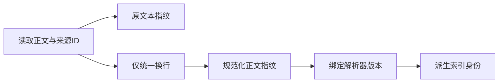
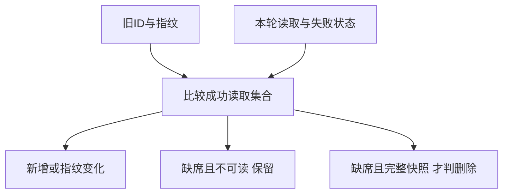
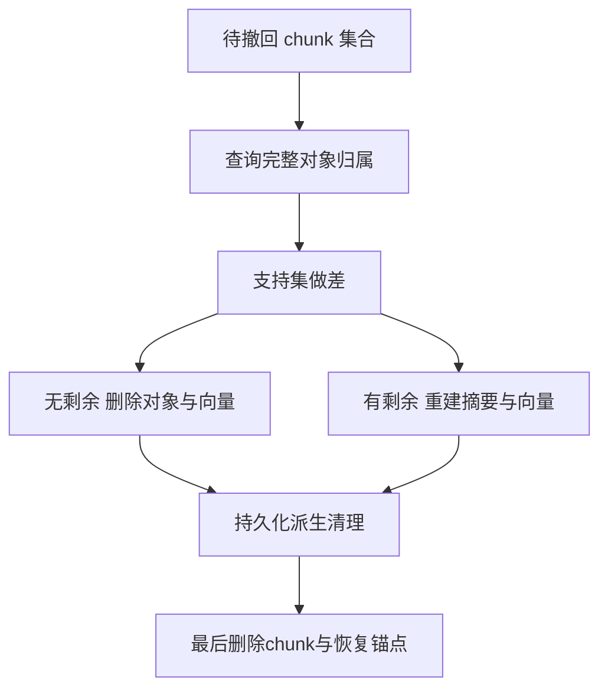

# 来源接入与版本管理

建库首先是来源工程：必须知道读到了什么、哪份版本支持哪些知识，以及更正如何传播。增量更新不是只把新文本追加到向量库。本页从来源指纹、变更分类和共享知识撤回三个机制解释索引保鲜。

## 学习目标

- 保存来源身份和读取范围
- 设计版本更正传播
- 保持解析质量

## 前置知识

需理解[RAG与引用回答](RAG与引用回答.md)、稳定ID、哈希、集合差与持久化状态。区分公开原文版本、采集快照、解析器版本和索引版本。

## 基本机制

来源接入至少保存source_id、URL、native_version、正文指纹、检查时间和实际读取范围。原论文的“新增图并入旧图”说明增量思想，但工程上还必须处理旧信息更正、删除、重试与跨存储失败。[LightRAG §3.1](https://arxiv.org/html/2410.05779v3)与[LightRAG 恢复契约](https://github.com/HKUDS/LightRAG/blob/aaebfe1bb8d55deb6a4304d357a3bf4c92fcd40a/docs/design/PurgeRecoveryContract.md)分别提供概念和实现层证据。

旧来源版本不应被新快照悄悄覆盖。知识正文、向量、图关系、摘要和练习答案均可能依赖旧版；应保留更正记录，让历史引用仍能解释当时结论。

## 推导或示例

完整教学文件：[ingestion.py](../../examples/knowledge/ingestion.py)。每个函数对应下列一个知识点，只使用标准库与小型合成输入；教学计算不代表模型或服务实验。

### 知识点一：来源身份、正文指纹和解析身份分开保存

URL只说明入口，不能冻结证据。来源稳定ID $s$ 应跨版本保持；正文指纹 $h=H(text)$ 指明读到哪份文本；解析或切分版本 $p$ 决定如何得到片段。教学索引身份定义为 $I=H(\mathrm{encode}(s,p,h))$ 。两份字节不同的HTML可能正文相同，正文相同也可能因解析器变更而产生不同片段边界。

我们保存原始文本指纹与仅统一换行后的指纹，避免把CRLF/LF差异等同知识更正。此处“原始文本”已是Unicode文本，不是原始PDF字节；如果需要证明PDF未变，还应另存原文件SHA。不能把两类摘要混称原文指纹。

将上述计算或状态约束集中写为：

$$
h=H(\mathrm{normalize}(text)),\qquad I=H\big(\mathrm{encode}(s,p,h)\big).
$$

```python
def source_fingerprint(source_id, text, parser_version):
    """分别保存原文本、保守规范化文本、解析身份；规范化不代表语义等价。"""
    if not all(isinstance(x, str) for x in (source_id, text, parser_version)) or not source_id or not parser_version:
        raise ValueError("来源与解析器版本须非空，正文须为字符串")
    normalized = text.replace("\r\n", "\n").replace("\r", "\n")
    digest = lambda s: hashlib.sha256(s.encode("utf-8")).hexdigest()
    text_hash = digest(normalized)
    identity = json.dumps([source_id, parser_version, text_hash], ensure_ascii=False, separators=(",", ":"))
    return {"raw_text_sha256": digest(text), "normalized_text_sha256": text_hash,
            "index_identity": digest(identity), "parser_version": parser_version}
```

输入 `a\r\nb` 与 `a\nb` 时，原文本指纹不同，规范化指纹相同。将parser-v1改为parser-v2，即使正文未变，索引身份仍改变。规范化特意不删除空格、标点或否定词；若把 `-1`和`1`、“禁止”与“允许”变成同一文本，就是有损规范化，而非无害清理。总时间与中间空间为 $O(n)$ ， $n$ 是文本编码长度。



该版本LightRAG `ainsert_custom_chunks`在未给doc_id时从全文生成doc key，随后以文档身份与chunk内容产生文档范围内的chunk身份，防止两文档相同文字覆盖彼此归属。这里使用SHA-256是本库的可查证教学设计，不声称与其内部ID算法逐字一致。原RAG论文也指出改变文档编码器会要求更新索引；因此仅检查原文没变，不能证明向量仍可兼容。来源卡还应记录作者原生版本、实际读取范围和解析缺口，日期不能替代这些身份。

[LightRAG ainsert_custom_chunks 身份](https://github.com/HKUDS/LightRAG/blob/aaebfe1bb8d55deb6a4304d357a3bf4c92fcd40a/lightrag/lightrag.py#L2430)；[LightRAG 来源归属约束](https://github.com/HKUDS/LightRAG/blob/aaebfe1bb8d55deb6a4304d357a3bf4c92fcd40a/docs/design/PurgeRecoveryContract.md)；[RAG §2.4 Training](https://arxiv.org/html/2005.11401v4).

### 知识点二：增量接入必须区分新增、更正、删除与不可读

给旧快照映射 $P:s\mapsto h$ 与本轮成功读取映射 $C:s\mapsto h$ ，新增为 $\mathrm{keys}(C)\setminus\mathrm{keys}(P)$ ；更正为共同ID中指纹不等的集合。删除不能简单定义成“本轮没读到”：网络失败、窗口采样、权限变化都可能让来源缺席。另存不可读集合 $U$ ，只有明确完整权威快照时，才将 $P\setminus C\setminus U$ 标记删除。

将上述计算或状态约束集中写为：

$$
\mathrm{added}=\mathrm{keys}(C)\setminus\mathrm{keys}(P),\quad \mathrm{changed}=\lbrace s\in\mathrm{keys}(C)\cap\mathrm{keys}(P):C(s)\ne P(s)\rbrace ,\quad \mathrm{missing}=\mathrm{keys}(P)\setminus\mathrm{keys}(C)\setminus U.
$$

```python
def classify_versions(previous, current, unavailable=(), complete_snapshot=False):
    """按稳定ID与指纹比较版本；暂不可读不视作删除，只有完整快照允许推断删除。"""
    old, new, unavailable = dict(previous), dict(current), set(unavailable)
    if unavailable & new.keys():
        raise ValueError("同一来源不能同时成功读取与不可读")
    common = old.keys() & new.keys()
    missing = old.keys() - new.keys() - unavailable
    return {"added": sorted(new.keys() - old.keys()),
            "changed": sorted(k for k in common if old[k] != new[k]),
            "unchanged": sorted(k for k in common if old[k] == new[k]),
            "removed": sorted(missing) if complete_snapshot else [],
            "unobserved": [] if complete_snapshot else sorted(missing),
            "unavailable": sorted(unavailable)}
```

旧库有A和B，本轮A指纹变化、B暂不可读，结果应是A changed、B unavailable，不能删除B。若只拉取最近一页来源列表，缺席来源应为unobserved；若确实列举了完整存活集合，才允许removed。计算依赖集合差与共同键，期望时间 $O(|P|+|C|+|U|)$ ，输出排序额外 $O(n\log n)$ ，不进行知识语义判断。



该版本GraphRAG `get_delta_docs`读取旧documents的title集合，用 `isin`区分新增和删除；`load_update_documents`最后只返回 `new_inputs`。因此A保留标题但正文更正时，该路径不会把A作为新增输入；返回的deleted_inputs也不代表调用方执行了删除传播。这个结论只针对所读版本和函数，不推断所有GraphRAG入口行为。

LightRAG论文的增量公式主要描述对新文档图做节点/边集合合并，不能据此声称任意更正与撤回都能靠集合并完成。更正需要撤销旧贡献再加入新贡献，且部分索引写成功时应保持可恢复状态。该版custom chunks路径先flush派生存储，最后写PROCESSED并清journal；“状态写完成”与“各派生对象都成功”要有明确顺序，不能先标完成后慢慢补向量。

[GraphRAG get_delta_docs](https://github.com/microsoft/graphrag/blob/c600ff80b77b9b62c47d539a3ac9569e95d8949b/packages/graphrag/graphrag/index/update/incremental_index.py#L29)；[GraphRAG load_update_documents](https://github.com/microsoft/graphrag/blob/c600ff80b77b9b62c47d539a3ac9569e95d8949b/packages/graphrag/graphrag/index/workflows/load_update_documents.py#L49)；[LightRAG §3.1 增量图合并](https://arxiv.org/html/2410.05779v3)；[LightRAG 提交顺序](https://github.com/HKUDS/LightRAG/blob/aaebfe1bb8d55deb6a4304d357a3bf4c92fcd40a/lightrag/lightrag.py#L2915).

### 知识点三：删除原文前先修复共享派生知识

一个实体可能来自多个chunk，删除一篇文档不等于删除该实体。对派生对象 $v$ 的完整支持集 $S_v$ ，撤回chunk集合为 $D$ ，新支持为 $S^\prime_v=S_v\setminus D$ 。若未变化则保留；若非空但减少则重建描述与向量；若为空则删除或按知识政策转为失效。

例如实体E由a、b支持，关系R仅由a支持，无关对象X由c支持。删除a后，E应从b重建，R应移除，X不受影响。若直接删E，会抹掉b仍支持的知识；若只删原文a不改E，旧摘要可能继续传播a中的错误结论。

将上述计算或状态约束集中写为：

$$
S_v^\prime=S_v\setminus D,\qquad \mathrm{action}(v)=\begin{cases}\mathrm{keep}&S_v^\prime=S_v\cr \mathrm{rebuild}&\varnothing\ne S_v^\prime\subsetneq S_v\cr \mathrm{delete}&S_v^\prime=\varnothing.\end{cases}
$$

```python
def reconcile_support(supports, removed_chunks):
    """删除片段后按剩余直接来源规划保留、重建或删除；不自动改写知识正文。"""
    removed = set(removed_chunks)
    result = {"unchanged": [], "rebuild": [], "delete": [], "surviving_supports": {}}
    for item, chunk_ids in supports.items():
        before = set(chunk_ids)
        if not before:
            raise ValueError("教学对象必须至少有一个已验证来源")
        after = before - removed
        result["surviving_supports"][item] = sorted(after)
        status = "unchanged" if before == after else "rebuild" if after else "delete"
        result[status].append(item)
    for name in ("unchanged", "rebuild", "delete"):
        result[name].sort()
    return result
```

函数为每个对象计算集合差，返回三类计划和剩余支持；不自动调用模型，更不保证剩余片段足以支持原来的每一句话。扫描所有支持边的核心成本为 $O(\sum_v|S_v|+|D|)$ ，排序输出另计。生产库可用倒排chunk→对象映射把扫描限制到受影响对象；教学版本全部扫描是为了让状态转换可检查。



该版LightRAG使用entity_chunks/relation_chunks作为完整归属，图中的source_id可能是截断展示，不能当成全部支持。`rebuild_knowledge_from_chunks`从存活chunk的缓存抽取结果重建；缺缓存会记录降级，不能伪称完整重建。`_purge_kg_contributions`先清理图、向量和tracking，再删除chunk，最后删除每文档恢复锚点。设计文档将它写成prepared→derived_committed→anchors_pending→completed的恢复阶段，缺必要归属证明时拒绝删除。

这些日志阶段不等于跨所有数据库的单事务。崩溃后应从已持久化阶段恢复；若先删锚点再失败，就失去了“这个文档影响过谁”的证据，重试可能永久漏清理。原论文只给增量新增的概念路径，删除语义必须由该版本具体实现与恢复契约佐证。

[LightRAG _purge_kg_contributions](https://github.com/HKUDS/LightRAG/blob/aaebfe1bb8d55deb6a4304d357a3bf4c92fcd40a/lightrag/lightrag.py#L6150)；[LightRAG rebuild_knowledge_from_chunks](https://github.com/HKUDS/LightRAG/blob/aaebfe1bb8d55deb6a4304d357a3bf4c92fcd40a/lightrag/operate.py#L1102)；[LightRAG Purge Recovery Contract](https://github.com/HKUDS/LightRAG/blob/aaebfe1bb8d55deb6a4304d357a3bf4c92fcd40a/docs/design/PurgeRecoveryContract.md)；[LightRAG §3.1](https://arxiv.org/html/2410.05779v3).

## 适用条件与限制

哈希能发现内容变化，不能证明语义变化或来源可信。表格丢列、公式丢符号可能令“成功解析”仍不可用；这类问题应登记读取缺口。全文不镜像时还须承认原站失效后的恢复限制。

常见误区：把检查日当发布日期，把一次抓取失败当撤回，把graph source_id的截断列表当完整归属，或把新增支持与旧结论矛盾视为自动无冲突合并。

## 实践任务

制作来源卡与变更卡，覆盖新增、仅换行、关键默认值更正、暂不可读四类事件。再模拟a/b共同支持实体E、a独立支持关系R，生成删除a的更新计划，列出应更新的图对象、向量、摘要和下游页面。手工在三个持久化边界设置失败点，说明哪些恢复锚点必须仍在。

本页完整实践保持 `designed`。示例测试由统一 UT 流程记录，本页不宣称已测试或论文复现。

## 掌握标准

能解释原文件指纹与规范化文本指纹不同；能检测同标题正文更正；能证明暂不可读不会触发删除；能根据剩余支持区分重建与移除。答案要包含删除顺序与崩溃恢复依据，不能只有“重新入库”四个字。


## 源码导读与边界推演

还需要区分“来源有新版”与“旧版立即失效”。论文v2可能只补充实验，旧版机制仍正确；也可能撤回核心公式，使旧声明失去支持。可以把对象状态拆成可读取、作者有效性、库内采用版本和本地复核状态，避免一个active字段承载全部语义。暂不可读只影响可读取性，不自动证明作者撤回；作者明确更正则需要检查哪些声明与该修订有关。旧学习记录仍绑定旧页面版本，不能自动改写成学习者已掌握新结论。

原始资料的解析质量同样影响身份。表格从两列读成一列、负号丢失、上下标变成普通字符，都可能产生新的正文指纹，但这并不一定是作者修改。来源卡应记录解析工具版本及缺失位置，并将作者修订与解析修复区分。重新切分后chunk ID改变时，旧引用不能直接定位到新的第几个chunk；应通过原始章节、页码或可核验文本片段重建映射，再更新支持关系。

更新索引不只涉及新增向量。若embedding模型或维度变化，旧向量与新查询编码可能不在同一空间，哪怕文本指纹完全一样，也不能直接混搜。若只改BM25分词器，则词项、posting和文档长度统计都可能变化；只给新增文档用新分词器会形成不可解释的混合索引。可以把解析、切分、词法索引、embedding、图抽取和摘要配置分别版本化，以便确定最小重建范围，而非一律全量重跑或一律不重建。

撤回时的恢复顺序可用一次失败推演检验。假设已删除关系向量但图边删除失败，此时恢复锚点与chunk仍在，重试可以定位同一批对象；若反过来先删chunk和锚点，再发现图边删除失败，就可能无法从剩余状态反查原贡献。设计文档中的阶段日志不是为了展示进度，而是为了记录哪些不可逆清理已经持久化、哪些还需执行。恢复时跳过已完成阶段，也避免多次调用LLM重建导致内容漂移。

教学 `reconcile_support`采用完整支持集合，因此能准确计算差集；实际图字段若只保留前若干个source_id，不能作为该函数的输入替代品。必须先从完整tracking或可信恢复锚点读取归属，否则删除一个可见来源后，可能误以为对象已经没有其他支持。

[完整归属与恢复契约](https://github.com/HKUDS/LightRAG/blob/aaebfe1bb8d55deb6a4304d357a3bf4c92fcd40a/docs/design/PurgeRecoveryContract.md)；[派生清理与归属载体顺序](https://github.com/HKUDS/LightRAG/blob/aaebfe1bb8d55deb6a4304d357a3bf4c92fcd40a/lightrag/lightrag.py#L6150)；[文档编码器与索引更新 §2.4](https://arxiv.org/html/2005.11401v4).

---

[返回模块](../modules/知识库.md) · [知识点索引](../../docs/知识点索引.md) · [完整教学代码](../../examples/knowledge/ingestion.py) · [提出更正](https://github.com/yanbozhang/llm-systems-wiki/issues/new?template=knowledge.yml)

觉得这篇推导有帮助，可以在 [GitHub](https://github.com/yanbozhang/llm-systems-wiki) 点 Star 收藏更新；分享时欢迎链接到具体知识点，便于读者复核公式、代码与来源。
