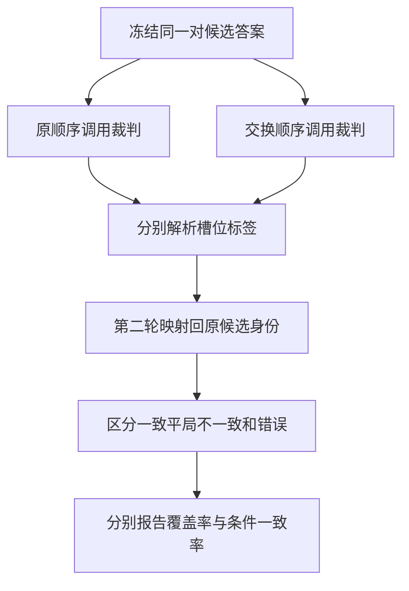
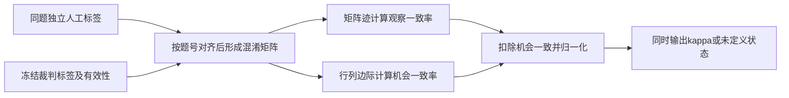
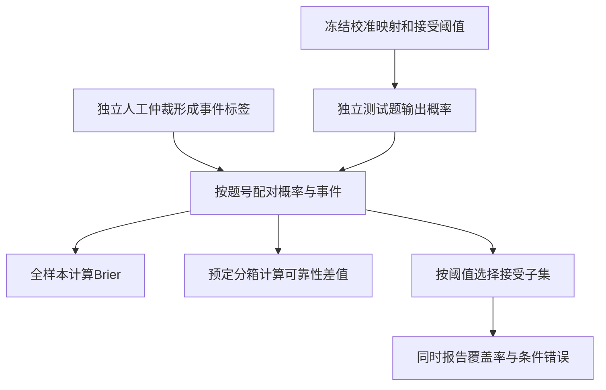

# 模型裁判与人工校准

模型裁判把评价标准转成判断或分数，但它仍是一个会出错的测量器。交换答案后是否一致、是否与人工一致、声称的置信度是否可信，是三个不同问题。本页分别给出对应的统计量；任何一项达标都不能代替另外两项，也不能自动证明候选答案真实正确。

## 学习目标

- 正确还原交换前后的候选身份，保留解析失败、不一致和平局三种状态。
- 从混淆矩阵推导观察一致率与 Cohen kappa，识别标签分布造成的假象。
- 定义裁判概率对应的事件，核算 Brier、分箱校准误差和自动接受的覆盖率。

## 前置知识

先阅读[评测协议与可复现性](评测协议与可复现性.md)与[评测指标与统计推断](评测指标与统计推断.md)。以下“候选 A/B”是被评价的答案身份，“展示槽位 A/B”是裁判看到的位置；它们在交换后不再相同。`tie` 表示已作出平局判断，`error` 表示没有成功解析出有效判断。

## 基本机制

| 角色 | 责任与输入输出 | 需要保留的边界 |
| --- | --- | --- |
| 被评系统 | 对同一任务产生冻结答案 | 不能利用裁判输出反复改写最终测试集答案 |
| 模型裁判 | 按量规、题目和可选参考答案判断 | 可能受位置、文风、长度或内容错误影响 |
| 评测宿主 | 匿名化、随机顺序、调用与解析、保存原文 | 不能把解析错误静默改成平局或零分 |
| 人工复核者 | 独立盲评、保留分歧，必要时仲裁 | 看到模型解释后改票不再是原始独立标注 |
| 校准流程 | 用独立数据建立分数到概率的关系 | 验证集选阈值与最终测试必须隔离 |

所读 FastChat 源码固定为 `587d5cfa1609a43d192cedb8441cac3c17db105d`；scikit-learn 为 `59106029d483678e79825f753bde67f8ade4332b`；LM Evaluation Harness 为 `d6de81643928d653435c431bae19945d41d32520`。官方 scikit-learn 网页快照标注 1.9.1；它用于核对概念，不被冒称为与源码提交完全相同的发行版本。MT-Bench 论文缓存的地址未带版本号，本组保留读取范围和文本 SHA256，不猜测论文版次。

## 推导或示例

### 知识点一：交换顺序必须先还原身份，再计算一致性

[MT-Bench 论文的位置偏置与交换策略](https://arxiv.org/html/2306.05685)展示了把同一对答案交换位置后裁判改变偏好的情况。一个保守策略是两次均支持同一候选才判胜；但“第一轮 A、第二轮 A”中的 A 如果都表示第一槽位，实际支持的是不同答案，不能算一致。

令 $x_{AB}\in\{-1,0,1\}$ 表示原顺序的槽位判断：第一槽位为 $1$，第二槽位为 $-1$，平局为 $0$。交换后的槽位判断记为 $x_{BA}$，还原到原候选身份需要取负。有效判断的交换一致条件为：

$$
C_i=\mathbf1[x_{AB,i}=-x_{BA,i}],\qquad
\mathrm{Consistency}_{valid}=\frac{\sum_{i\in V}C_i}{|V|}.
$$

$V$ 是两次都成功解析的题目集合。解析错误不属于上述三值空间；它既不是零，也不是一次有效弃权。若总题数为 $N$，还需报告双次有效覆盖率 $|V|/N$，以及调用层面的解析覆盖率“有效调用数 / $2N$”。覆盖率很低时，只在少数容易解析的题上获得高一致性没有足够解释力。

```python
def swapped_pair_summary(rows):
    """A/B指展示槽位；将第二轮交换结果映射回原候选，保留错误与不一致。"""
    if not rows or len({row['id'] for row in rows}) != len(rows):
        raise ValueError("题目须非空且ID唯一")
    reverse = {'A': 'B', 'B': 'A', 'tie': 'tie'}
    counts = dict.fromkeys(('A', 'B', 'tie', 'inconsistent', 'invalid'), 0)
    valid_calls = first_choices = decisive_calls = 0
    details = []
    for row in rows:
        ab, ba = row['winner_ab'], row['winner_ba']
        if ab not in ('A', 'B', 'tie', 'error') or ba not in ('A', 'B', 'tie', 'error'):
            raise ValueError("解析失败须显式使用error，不可转成tie")
        for label in (ab, ba):
            valid_calls += label != 'error'
            decisive_calls += label in ('A', 'B')
            first_choices += label == 'A'
        if 'error' in (ab, ba):
            result = 'invalid'
        else:
            result = ab if ab == reverse[ba] else 'inconsistent'
        counts[result] += 1
        details.append({'id': row['id'], 'original_order': ab,
                        'swapped_to_original': reverse.get(ba), 'result': result})
    valid_pairs = len(rows) - counts['invalid']
    consistent = sum(counts[label] for label in ('A', 'B', 'tie'))
    return {'pairs': len(rows), 'counts': counts, 'details': details,
            'parse_coverage': valid_calls / (2 * len(rows)),
            'valid_pair_coverage': valid_pairs / len(rows),
            'consistency_on_valid_pairs': consistent / valid_pairs if valid_pairs else None,
            'consistent_pair_fraction': consistent / len(rows),
            'first_slot_fraction_on_decisive_calls': first_choices / decisive_calls if decisive_calls else None}
```

函数将第二轮 `A` 映射成原候选 `B`，将第二轮 `B` 映射成原候选 `A`；先检查错误，再比较身份。`counts` 保留原候选 A 胜、B 胜、平局、不一致和无效五类。`first_slot_fraction_on_decisive_calls` 只统计非平局有效调用中第一位置被选中的比例，是描述统计，不自动构成位置偏置的因果估计。

手算四题：`(A,B)` 是原候选 A 两胜；`(A,A)` 是身份翻转；`(tie,tie)` 是稳定平局；`(error,B)` 无效。因此解析覆盖率 $7/8$，双次有效覆盖率 $3/4$，有效题一致率 $2/3$，全题中可确认一致的比例 $2/4$。这四个数有不同分母，不能只挑最大的一个作报告标题。



**固定源码导读。** [play_a_match_pair 的双次调用和身份映射](https://github.com/lm-sys/FastChat/blob/587d5cfa1609a43d192cedb8441cac3c17db105d/fastchat/llm_judge/common.py#L313-L354)实际调用两次 `run_judge_pair`，第二次交换答案，并分别用 `g1_map`、`g2_map` 映射。[run_judge_pair 的格式解析](https://github.com/lm-sys/FastChat/blob/587d5cfa1609a43d192cedb8441cac3c17db105d/fastchat/llm_judge/common.py#L235-L310)返回 `A/B/tie/error`；调用方还保存提示、原始裁判文本、题号、模板和模型标识。[load_pairwise_model_judgments](https://github.com/lm-sys/FastChat/blob/587d5cfa1609a43d192cedb8441cac3c17db105d/fastchat/llm_judge/common.py#L546-L586)将交换结果不同的记录标为 `inconsistent`。教学函数在此基础上显式把任一 `error` 归为无效，不能声称源码加载器已完成全部无效值清洗。

论文某些实验把不一致合并为平局；这是分析口径，而所读加载器保留了独立状态。应先保存原始五类，再按预注册规则汇总，避免不可逆信息损失。两次都判平局也只能说明一致，不能说明这对答案实际上等价。若两次都选第一位置，可能是位置影响，也可能有随机性、模板差异或解析问题；识别系统性偏置需要固定内容、量规与版本，随机分配顺序并做重复配对比较。交换只能缓解或暴露位置问题，不能清除偏好冗长或错误参考答案等偏差。

### 知识点二：人工一致率必须连同标签边际与退化情形解释

人工标签不是自动正确的金标准。应先在同一题上独立标注、保存原始票，再按明确规则仲裁。[MT-Bench 的人工一致性实验与 Table 5](https://arxiv.org/html/2306.05685)区分包含平局和不一致的 S1，以及只含非平局票的 S2；它还定义了随机选择两类评审者比较的抽样机制。换掉平局处理、评审者或样本筛选，就不是同一个百分比。本例演示固定一对人工/模型标签的计算，不复制论文的多人投票抽样。

取标签集合 $\mathcal{L}=\{A,B,\mathrm{tie}\}$。令 $M_{ab}$ 为人工标签 $a$、裁判标签 $b$ 的题数；行和 $r_a$、列和 $c_a$，总题数 $N=\sum M_{ab}$。观察一致率和以经验边际为基准的随机一致率分别为：

$$
p_o=\frac{\sum_a M_{aa}}N,\qquad
p_e=\sum_a\frac{r_a}{N}\frac{c_a}{N},\qquad
\kappa=\frac{p_o-p_e}{1-p_e}.
$$

推导中的 $p_e$ 假设两方按各自经验标签频率独立抽取标签，用作机会一致的参照，不是在断言现实评审者随机投票。分子是超出该参照的一致量，分母是从参照到完全一致的剩余空间。交换人工与模型会转置矩阵，迹不变、边际乘积不变，因此未加权 $\kappa$ 对称。

```python
def agreement_audit(human_labels, judge_labels):
    """计算同题配对的三分类混淆矩阵和未加权kappa；退化分母返回None。"""
    if not human_labels or len(human_labels) != len(judge_labels):
        raise ValueError("标签须非空、等长，并由调用方按同一题目顺序配对")
    labels = ('A', 'B', 'tie')
    if any(label not in labels for label in (*human_labels, *judge_labels)):
        raise ValueError("无效解析或缺失标签须先单独报告，不能当作tie")
    matrix = [[0] * len(labels) for _ in labels]
    for human, judge in zip(human_labels, judge_labels):
        matrix[labels.index(human)][labels.index(judge)] += 1
    n = len(human_labels)
    row_totals = [sum(row) for row in matrix]
    col_totals = [sum(matrix[i][j] for i in range(len(labels))) for j in range(len(labels))]
    diagonal = sum(matrix[i][i] for i in range(len(labels)))
    expected_numerator = sum(a * b for a, b in zip(row_totals, col_totals))
    denominator = n * n - expected_numerator
    kappa = (n * diagonal - expected_numerator) / denominator if denominator else None
    return {'n': n, 'labels': labels, 'matrix': matrix,
            'human_marginals': row_totals, 'judge_marginals': col_totals,
            'observed_agreement': diagonal / n,
            'chance_agreement': expected_numerator / (n * n), 'kappa': kappa}
```

函数接收已按题号对齐的标签序列；它只校验长度和值域，题目身份对齐由宿主负责。随后建立三乘三矩阵，用整数 $N^2-\sum r_ac_a$ 判断退化分母，避免把单一共同类别的 $0/0$ 偷换成满分。返回 `None` 表示未定义；无效解析须在入口外统计覆盖率，不能伪造为 `tie`。

`demo()` 的六题得到矩阵：

| 人工行 / 裁判列 | A | B | tie | 行和 |
| --- | --- | --- | --- | --- |
| A | 2 | 1 | 0 | 3 |
| B | 0 | 1 | 0 | 1 |
| tie | 0 | 1 | 1 | 2 |
| 列和 | 2 | 3 | 1 | 6 |

因此 $p_o=4/6$，$p_e=(3\times2+1\times3+2\times1)/36=11/36$，$\kappa=(24-11)/(36-11)=13/25=0.52$。反例是人工 95 题选 A、5 题选 B，模型全选 A：观察一致率 95%，机会一致也为 95%，所以 $\kappa=0$。若双方一百题全选 A，则 $p_e=1$，$\kappa$ 未定义；不能凭完美观察一致率声称裁判有区分能力。



**固定源码导读。** [cohen_kappa_score 的混淆矩阵与机会分布](https://github.com/scikit-learn/scikit-learn/blob/59106029d483678e79825f753bde67f8ade4332b/sklearn/metrics/_classification.py#L977-L1033)从 `confusion_matrix` 得到边际外积，再计算加权不一致的比率；`weights=None` 时等价于上式。本例只实现未加权情况，因为 A、B、平局是名义类别，没有自然的等距顺序，不能随意套用线性或平方距离。[Cohen kappa 官方定义、对称性与未定义条件](https://scikit-learn.org/stable/modules/generated/sklearn.metrics.cohen_kappa_score.html)说明其机会校正口径；所读版本的 `replace_undefined_by` 提供退化值替换，教学代码选择明确的 `None`。

一致性不是事实正确性：人工与模型可能共享同一错误参考，或者都偏好流畅长文。报告中还应按任务类别、答案差距和争议比例分层，保留盲评与仲裁后的标签版本。不能把某个通用 $\kappa$ 阈值当作所有业务的发布标准；业务容错、类别分布与样本规模都参与解释。

### 知识点三：校准的是明确事件的概率，覆盖率与条件错误必须同时报告

先定义事件 $Y_i=1$：第 $i$ 题模型裁判的结论与独立人工仲裁一致。候选回答本身是否正确是另一个事件，不能混用标签。设 $p_i\in[0,1]$ 是校准流程给出的 $Y_i=1$ 概率，裁判自报“9分”不是天然的 $0.9$。[官方概率校准与可靠性曲线说明](https://scikit-learn.org/stable/modules/calibration.html)将校准表述为预测概率与条件事件频率的一致，例如预测约 0.8 的样本中约 80% 发生该事件。

二值 Brier 损失为 $\mathrm{BS}=N^{-1}\sum_i(p_i-y_i)^2$。若某组样本的真实事件概率为 $q$，则：

$$
\mathbb E[(p-Y)^2]=q(p-1)^2+(1-q)p^2=(p-q)^2+q(1-q).
$$

对 $p$ 求导得 $2(p-q)$，最小值在 $p=q$。这解释了平方损失为何奖励诚实概率；但不同模型间 Brier 同时受校准、区分度和数据不确定性影响，较低分数本身不证明校准单独改善。

把概率按预先设定的区间分成 $B_m$，分箱校准误差与阈值接受策略为：

$$
\mathrm{ECE}=\sum_{m:|B_m|>0}\frac{|B_m|}{N}\left|\overline p_m-\overline y_m\right|,
\quad C_\tau=\frac{\sum_i\mathbf1[p_i\ge\tau]}N,
\quad E_\tau=\frac{\sum_i\mathbf1\{p_i\ge\tau\}(1-y_i)}{\sum_i\mathbf1[p_i\ge\tau]}.
$$

其中 $C_\tau$ 是自动接受覆盖率，$E_\tau$ 是已接受子集的条件错误率。没有样本被接受时，错误率未定义，不能写成零误差。固定分箱可比性同样重要：箱内正负误差会抵消，换箱数也会改变 ECE；它不是可靠性的完备证书。

```python
def calibration_audit(probabilities, correctness, bins=2, threshold=0.8):
    """评估与独立人工仲裁一致这一事件的预测概率；不拟合校准器或调阈值。"""
    import math
    if not probabilities or len(probabilities) != len(correctness):
        raise ValueError("概率和事件标签须非空且等长")
    if type(bins) is not int or bins <= 0:
        raise ValueError("分箱数须为正整数")
    if any(type(p) not in (int, float) or not math.isfinite(p) or not 0 <= p <= 1
           for p in (*probabilities, threshold)):
        raise ValueError("概率和阈值须为有限的零到一数值")
    if any(type(y) not in (int, bool) or y not in (0, 1) for y in correctness):
        raise ValueError("事件标签须为明确的零或一")
    n = len(probabilities)
    groups = [[] for _ in range(bins)]
    accepted = []
    for p, y in zip(probabilities, correctness):
        groups[min(int(p * bins), bins - 1)].append((p, y))
        if p >= threshold:
            accepted.append(y)
    reliability = []
    ece = 0.0
    for index, group in enumerate(groups):
        mean_p = sum(p for p, _ in group) / len(group) if group else None
        frequency = sum(y for _, y in group) / len(group) if group else None
        if group:
            ece += len(group) / n * abs(mean_p - frequency)
        reliability.append({'bin': index, 'count': len(group),
                            'mean_probability': mean_p, 'event_frequency': frequency})
    return {'n': n, 'binary_brier': sum((p - y) ** 2 for p, y in zip(probabilities, correctness)) / n,
            'ece': ece, 'reliability': reliability, 'threshold': threshold,
            'accepted': len(accepted), 'coverage': len(accepted) / n,
            'accepted_error': 1 - sum(accepted) / len(accepted) if accepted else None}
```

输入是对齐的有限概率与明确的 0/1 事件标签。代码使用等宽箱，内部边界归右箱，概率 1 归最后一箱；空箱保留计数零与空均值。它同时计算全样本 Brier、分箱均值和固定阈值的条件错误，没有用当前标签拟合校准器或搜索最佳阈值。

手算 $p=[0.9,0.8,0.6,0.2]$、$y=[1,1,0,0]$：$\mathrm{BS}=(0.01+0.04+0.36+0.04)/4=0.1125$。取两箱 $[0,0.5)$、$[0.5,1]$，第一箱贡献 $\tfrac14|0.2-0|=0.05$，第二箱贡献 $\tfrac34|\tfrac{2.3}{3}-\tfrac23|=0.075$，故 ECE 为 0.125。阈值 0.8 接受两题，覆盖率 1/2，样本内条件错误为零；这只有两题，不能推断未来错误率为零。



**固定源码导读。** [LM Evaluation Harness 的 brier_score](https://github.com/EleutherAI/lm-evaluation-harness/blob/d6de81643928d653435c431bae19945d41d32520/lm_eval/api/metrics.py#L156-L163)把标签展开成 one-hot 后，对所有类别平方差求和，再按样本平均。二分类预测向量为 $(1-p,p)$，标签向量为 $(1-y,y)$，该实现的损失是 $2(p-y)^2$，所以同一算例在其多类求和口径下是 0.225。必须报告采用哪种缩放，不能把 0.1125 与 0.225 当作性能差异。

[官方指南的独立校准数据与 Brier 分解说明](https://scikit-learn.org/stable/modules/calibration.html)指出校准数据需要独立于基础模型拟合数据；本页进一步要求用独立验证集选接受阈值，再冻结后评估最终测试集。可用交叉拟合节约样本，但相同题目、近重复答案或同一模板派生项仍需按组切分。教程未训练校准器；生产中应记录映射版本、目标事件、训练来源和分布变化。语言、题型或裁判版本改变后，旧映射未必保持有效。

## 适用条件与限制

模型裁判适合量规较明确、规模较大的初步评价；高风险事实或复杂执行结果需要独立证据与人工复核。增加参考答案可能改善判断，也可能把参考中的错误传给裁判。匿名化、交换顺序和长度分析各自针对特定偏差，不能将它们相加解释为裁判已无偏。

人类一致性和概率校准应在与目标业务相近的数据分布中报告。对同题多个裁判或多个候选的统计，要保留题目层级相关性，不能将重复评分当作独立新问题。论文报告的是其特定任务、模型与采样协议的结果，本页没有复现其中的模型成绩。

## 实践任务

完整实现见[benchmark-judge.py](../../examples/benchmark/benchmark-judge.py)。设计四类配对结果：稳定胜出、稳定平局、交换翻转、解析错误；再准备人工与模型标签表及一份独立概率审计表。交付原始标签、题号对齐依据、五类状态计数、混淆矩阵、分箱表与阈值覆盖率，使用[实验记录模板](../../templates/实验记录模板.md)保存未筛选的样本分母。

交接给主 agent 常驻 UT：原顺序 A/交换 B 必须归同一候选；双错误不能算平局；无有效对时一致率为 `None`；kappa 对交换评审者不变且单类退化未定义；已给矩阵得到 0.52；概率边界 0 和 1 归箱正确，空箱不伪造频率；算例 Brier 为 0.1125、ECE 为 0.125；无接受样本时条件错误为 `None`。本组未运行这些测试或示例。

## 掌握标准

能解释为什么槽位 A/A 不是候选一致；能说明只报告非平局一致率遗漏了什么；能从边际分布推导 95% 观察一致但 kappa 为零；能区分“裁判与人工一致的概率”与“答案正确的概率”；能给出校准、阈值选择和最终评估三者的数据隔离方案。

本页基于已读论文、官方文档和固定源码。未进行真人盲评、裁判 API 调用、校准器拟合或模型成绩复现。返回[Benchmark模块](../modules/Benchmark.md)，继续阅读[稳健性与工具安全评测](稳健性与工具安全评测.md)。

---

[返回模块](../modules/Benchmark.md) · [知识点索引](../../docs/知识点索引.md) · [完整教学代码](../../examples/benchmark/benchmark-judge.py) · [提出更正](https://github.com/yanbozhang/llm-systems-wiki/issues/new?template=knowledge.yml)

觉得这篇推导有帮助，可以在 [GitHub](https://github.com/yanbozhang/llm-systems-wiki) 点 Star 收藏更新；分享时欢迎链接到具体知识点，便于读者复核公式、代码与来源。
