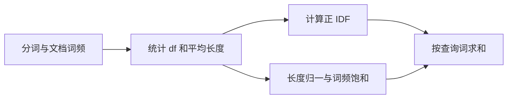
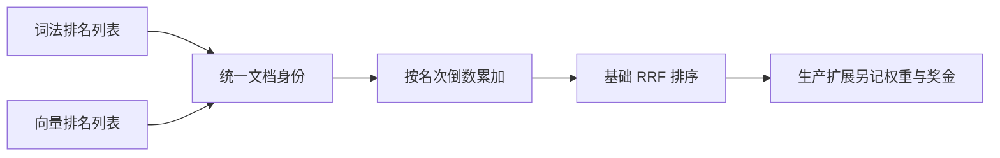
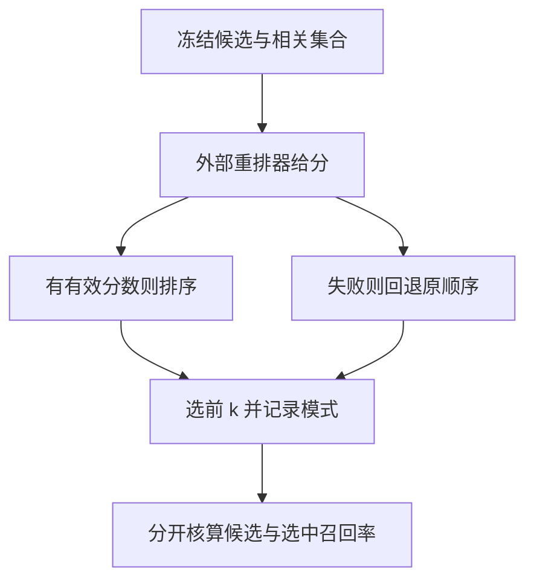

# 混合检索与重排

混合检索将词法、向量等候选合并，再在有限候选内做更贵的重排。本页沿着BM25评分、RRF融合和重排漏斗逐层手算，明确公式与当前维护者实现之间的差异。

## 学习目标

- 识别不同召回器的优劣
- 理解排序融合
- 分阶段定位检索失败

## 前置知识

需理解[RAG与引用回答](RAG与引用回答.md)、对数、排序和集合召回率。向量相似度、BM25、RRF总分与模型重排分数各有口径，不能未经定义直接相加。

## 基本机制

词法索引可捕捉标识符与精确术语，向量路径可补充语义表达；融合依赖统一候选身份，重排与上下文预算继续筛选。[qmd Score Normalization & Fusion](https://github.com/tobi/qmd/blob/86d2365d17fc682e491c2c53d1e4a884aee8682a/README.md)提供组合路径，[RRF原论文](https://plg.uwaterloo.ca/~gvcormac/cormacksigir09-rrf.pdf)给出基础融合公式。

源码核对非常必要：所读qmd README归一化表仍写FTS取绝对值，当前 `store.ts`已采用 $|x|/(1+|x|)$ 的饱和映射。本文不依据该表声称当前后端分数范围，以固定提交实现路径与显式教学公式为准。[qmd FTS评分映射](https://github.com/tobi/qmd/blob/86d2365d17fc682e491c2c53d1e4a884aee8682a/src/store.ts#L4774)

## 推导或示例

完整教学文件：[hybrid-search.py](../../examples/knowledge/hybrid-search.py)。每个函数对应下列一个知识点，只使用标准库与小型合成输入；教学计算不代表模型或服务实验。

### 知识点一：BM25如何同时控制稀有词、词频饱和与长度

关键词匹配不只是数出现次数。设教学语料含 $N$ 篇文档，词 $t$ 出现在 $df_t$ 篇，文档 $d$ 内频率为 $f_{t,d}$、长度为 $|d|$，平均长度为 $\overline l$。本例采用：

$$\mathrm{IDF}(t)=\ln\left(1+\frac{N-df_t+0.5}{df_t+0.5}\right),$$
$$\mathrm{BM25}(q,d)=\sum_{t\in q}\mathrm{IDF}(t)\frac{f_{t,d}(k_1+1)}{f_{t,d}+k_1(1-b+b|d|/\overline l)}.$$

所有比值及分数均无量纲。IDF让稀有词更有区分力；分母使词频增长的收益饱和；$b=0$忽略长度，$b=1$完全采用相对长度因子。固定长度归一项 $K>0$，$f/(f+K)$的导数为 $K/(f+K)^2$，随词频增大而变小。因此复制关键词十次不等于得分十倍。

```python
def bm25_scores(query_terms, documents, k1=1.2, b=0.75):
    """二值查询词的BM25；documents是已分词列表，采用正IDF和(k1+1)因子。"""
    if not math.isfinite(k1) or not math.isfinite(b) or k1 < 0 or not 0 <= b <= 1:
        raise ValueError("k1须非负，b须在 [0,1]")
    docs = [list(d) for d in documents]
    if not docs:
        return []
    avgdl = sum(map(len, docs)) / len(docs)
    if avgdl == 0:
        return [0.0] * len(docs)
    terms = set(query_terms)
    counts = [Counter(d) for d in docs]
    df = {t: sum(t in c for c in counts) for t in terms}
    result = []
    for doc, count in zip(docs, counts):
        score = 0.0
        norm = k1 * (1 - b + b * len(doc) / avgdl)
        for term in terms:
            freq = count[term]
            if freq:
                idf = math.log1p((len(docs) - df[term] + 0.5) / (df[term] + 0.5))
                score += idf * freq * (k1 + 1) / (freq + norm)
        result.append(score)
    return result
```

手算 $N=3,df=1$ 时IDF为 $\ln(8/3)\approx0.9808$。取 $k_1=1.2,b=0.75,|d|=\overline l$，$f=1$的词频因子为1，$f=2$为1.375，极限为2.2。固定词频1但文档长为均长两倍，归一项变成2.1，因子降为2.2/3.1。生产语料里复制词也改变长度与均长，不能同时把这些变量都视为常数。



该版本Lucene `idf`与正IDF式一致，`BM25Scorer.doScore`为 `weight-weight/(1+freq*normInverse)`，等价于省略公共 $(k_1+1)$ 因子的形式；同一 $k_1$ 下排序可相同，数值不应直接比。Lucene还将长度编码入norm查表，且本次源码出现可选查询词频参数k3；教学按查询词集合计算，不冒充完整Lucene。代码建Counter成本 $O(\sum|d|)$，随后 $O(N|q|)$评分；倒排索引可仅访问命中posting。中文分词、标识符切分和停用词会改变df，必须连同语料版本固定。

[Lucene idf 与 avgFieldLength](https://github.com/apache/lucene/blob/ea57360912ed31ae2f2c0a7a5fef422ddf4e06b0/lucene/core/src/java/org/apache/lucene/search/similarities/BM25Similarity.java#L138)；[Lucene BM25Scorer.doScore](https://github.com/apache/lucene/blob/ea57360912ed31ae2f2c0a7a5fef422ddf4e06b0/lucene/core/src/java/org/apache/lucene/search/similarities/BM25Similarity.java#L257)；[Lucene BM25Similarity 官方API](https://lucene.apache.org/core/10_3_1/core/org/apache/lucene/search/similarities/BM25Similarity.html).

### 知识点二：RRF融合的是名次，工程加分会改变结论

BM25分数、向量相似度和重排logit不共享概率尺度。RRF绕开原始分数，使用各召回器内的排名：

$$S(d)=\sum_{j:d\in R_j}\frac{w_j}{c+r_j(d)},\quad r_j(d)\in\{1,2,\ldots\},\quad c\ge0.$$

缺席项贡献0；$w_j$控制召回路径权重，$c$降低首名与后面名次的相对差异。原RRF论文将60作为先导实验选定后固定的常数，不是跨所有语料的最优定理。一个检索器原始分数从100变成1000但排序不变，基础RRF结果也不变；这个不变性同时意味着它丢失了分数间距信息。

```python
def reciprocal_rank_fusion(rankings, constant=60.0, weights=None):
    """基础加权RRF：排名从1开始，缺席贡献0；不包含qmd的额外名次奖金。"""
    lists = [list(r) for r in rankings]
    weights = [1.0] * len(lists) if weights is None else list(weights)
    if not math.isfinite(constant) or constant < 0 or len(weights) != len(lists):
        raise ValueError("常数须非负，权重数量须匹配")
    if any(not math.isfinite(w) or w < 0 for w in weights):
        raise ValueError("权重须为有限非负数")
    scores, first_seen = {}, {}
    for ranking, weight in zip(lists, weights):
        if len(set(ranking)) != len(ranking):
            raise ValueError("单个排名列表不应有重复文档")
        for rank, doc in enumerate(ranking, 1):
            first_seen.setdefault(doc, len(first_seen))
            scores[doc] = scores.get(doc, 0.0) + weight / (constant + rank)
    return sorted(scores.items(), key=lambda x: (-x[1], first_seen[x[0]]))
```

当A分别排名1与10，$S(A)=1/61+1/70\approx0.030679$；B两路都排3，$S(B)=2/63\approx0.031746$，基础RRF偏向B。该版qmd `reciprocalRankFusion`额外给任一路第一名加0.05、最好名次2至3加0.02，于是A约0.080679、B约0.051746，顺序反转。这个工程奖金可能大于基础RRF分数本身；只写“用了RRF”不足以复现最终排序。



函数实现基础加权公式，不含qmd奖金。总候选条目数 $M$、去重文档数 $U$，累加期望 $O(M)$，排序 $O(U\log U)$，空间 $O(U)$；同分按首次出现顺序稳定输出。单路重复文档会不当重复投票，因此示例直接拒绝。完全相同召回器复制成多路，也会让共识被放大而没有新增证据。融合前必须统一版本化chunk身份或文档身份，不能一条按文件、一条按段落却声称投票对象相同。

[Cormack 等 RRF 原论文 §1](https://plg.uwaterloo.ca/~gvcormac/cormacksigir09-rrf.pdf)；[qmd reciprocalRankFusion](https://github.com/tobi/qmd/blob/86d2365d17fc682e491c2c53d1e4a884aee8682a/src/store.ts#L5371)；[qmd Fusion Strategy](https://github.com/tobi/qmd/blob/86d2365d17fc682e491c2c53d1e4a884aee8682a/README.md#L543).

### 知识点三：重排只在候选内工作，必须记录漏斗与回退

双编码器可预存文档向量，以 $q^\top d$快速召回；交叉编码器或LLM重排让查询与候选共同进入模型，得到 $s(q,d)=f_\theta(\mathrm{concat}(q,d))$。它计算更贵，所以通常只处理已召回的 $K$ 项。分数不是自动校准的事实正确概率，也不会把候选外的相关文档凭空加入。

对独立标注的相关集合 $G$、召回候选 $C$、最终选中 $S\subseteq C$，有：

$$\mathrm{Recall}_{cand}=|G\cap C|/|G|,\quad \mathrm{Recall}_{selected}=|G\cap S|/|G|\le\mathrm{Recall}_{cand}.$$

```python
def rerank_audit(candidates, model_scores, relevant, top_k):
    """在既定候选内按外部模型分数重排；None表示回退原排序，并审计漏召回。"""
    candidates = list(candidates)
    relevant = set(relevant)
    if type(top_k) is not int or top_k < 1 or len(set(candidates)) != len(candidates):
        raise ValueError("top_k须为正整数，候选不得重复")
    if model_scores is None:
        ordered = candidates
        mode = "fallback"
    else:
        if set(model_scores) != set(candidates) or any(not math.isfinite(v) for v in model_scores.values()):
            raise ValueError("每个候选须恰有一个有限分数，不可插入外部文档")
        ordered = sorted(candidates, key=lambda d: -model_scores[d])
        mode = "reranked"
    selected = ordered[:top_k]
    return {"selected": selected, "mode": mode,
            "missing_from_candidates": sorted(relevant - set(candidates)),
            "candidate_recall": len(relevant & set(candidates)) / len(relevant) if relevant else None,
            "selected_recall": len(relevant & set(selected)) / len(relevant) if relevant else None}
```

相关证据为A、B，候选只有A、C，即使重排把A排第一，候选召回率和最终召回率最多都是1/2。示例用外部给定分数排序，保证不会偷偷插入B；分数为None时回退原顺序并明确标记fallback。空相关集合时Recall未定义，返回None；无答案问题需要另外评估拒答和虚假证据率。



该版LightRAG `apply_rerank_if_enabled`按返回index映射原文档，模型未配置、空结果或异常时会退回原候选；因此配置上写enable并不能证明每次真的重排。qmd当前查询路径先截候选，再选每文档一个chunk送重排；正确证据在文档其他chunk中时，这一步也可能丢失。它还把融合后的排名转换成 $1/r$，按名次区间与重排分数加权，不能把这项position score误认为原始RRF总分。

排序示例为 $O(K\log K)$；真实重排模型还需为每个候选执行昂贵推断，不能只报Python排序成本。建议保存各路候选名次、融合贡献、选中chunk、重排分数、回退原因与最终预算；先定位漏召回、错选chunk或重排退化，再决定是否升级embedding。

[LightRAG apply_rerank_if_enabled](https://github.com/HKUDS/LightRAG/blob/aaebfe1bb8d55deb6a4304d357a3bf4c92fcd40a/lightrag/utils.py#L6924)；[qmd 候选截断与chunk选择](https://github.com/tobi/qmd/blob/86d2365d17fc682e491c2c53d1e4a884aee8682a/src/store.ts#L6397)；[qmd position-aware blending](https://github.com/tobi/qmd/blob/86d2365d17fc682e491c2c53d1e4a884aee8682a/src/store.ts#L6500)；[qmd Fusion Strategy](https://github.com/tobi/qmd/blob/86d2365d17fc682e491c2c53d1e4a884aee8682a/README.md#L543)；[RAG §2.2 检索与生成边界](https://arxiv.org/html/2005.11401v4).

## 适用条件与限制

选择多路检索会增加索引同步、查询延迟和评测成本。ANN近似召回、中文分词和版本过滤都会影响候选；RRF不能纠正错误身份或失效来源。BM25教学实现全扫语料，适合手算，不能作为生产吞吐评估。

常见误区：重排一定提升答案，多个相似召回器就是多份独立证据，或一个高分就证明事实成立。必须继续检查证据支持与来源版本。

## 实践任务

设计精确术语、同义表达、长查询、无答案四类问题，保存各路候选与融合贡献。手算A与B的基础RRF，再加入qmd奖金观察反转。为重排构造候选漏B、模型失败回退、文档内错选chunk三个失败例，分别确定应修复的阶段。

本页完整实践保持 `designed`。示例测试由统一 UT 流程记录，本页不宣称已测试或论文复现。

## 掌握标准

能解释BM25饱和与长度惩罚；能正确处理排名从1开始和缺席贡献0；能区分基础RRF、奖金和最终position混合分。答案需证明选中集合是候选子集，且不能用重排补救根本未召回的证据。


## 源码导读与边界推演

一个可解释的混合检索结果至少需要保存五种量：后端原始分数、后端名次、各路RRF贡献、工程额外加分、最终重排分数。它们不能共用一个名为score的列而丢失阶段。以A的基础RRF约0.030679为例，加0.05奖金以后已经约0.080679；如果随后又转换为融合排名的倒数 $1/r$，数值的含义再次改变。只保存最后一个0到1的分数，无法回放哪个召回器使结果上升，也不能判断变化源于模型还是规则。

BM25的语料统计有全局影响。新增很多包含常见词的文档会改变 $N$、$df$和平均长度，所以原文档内容未变，其得分也可能变。检索回归应固定语料版本，而不仅固定查询集合。Lucene的docCount是字段层统计，不一定等于数据库全部记录数；教学函数则以传入文档列表作为语料，空文档输入的统计语义由调用者决定。生产字段缺失、位置重叠与长度编码都应按实际索引配置解释，不能期待自写浮点公式与后端得分逐位一致。

词法与向量的互补性也取决于查询类型。“ERR_CACHE_17”这样的精确标识符需要检查分词后是否仍保留；“启动后第一字很慢”这样的描述可能与“首token延迟”语义接近，却没有共同词项。向量路径可产生有用候选，但若混入历史版本或无权限文档，语义相似仍不构成可用证据。过滤位置应作为协议的一部分记录，因为先取top-k再过滤与先过滤再取top-k可能得到不同数量和质量的候选。

融合列表长度同样是参数。将一条召回器top-10改为top-100会给更多文档增加微小贡献，结果不再是仅修改展示数量。$c$较大时不同靠前名次的差别变小，多路出现更容易主导；$c$较小时头部名次差更显著。复制同一路列表相当于增加其权重，不能把它解释为两条独立知识证据。若两路返回的粒度不同，应先选定文档级或chunk级身份再融合。

重排后还需看预算和答案支持。候选A虽排第一，却长到无法放入上下文时，实际模型可能只看见B；此时重排指标改善也不会直接传到回答指标。应以冻结的输入逐阶段记录漏斗，定位哪一步把完整证据变成不完整证据，再讨论扩大候选、切分、增加预算或重排模型哪个选项真正相关。

[字段统计与norm](https://github.com/apache/lucene/blob/ea57360912ed31ae2f2c0a7a5fef422ddf4e06b0/lucene/core/src/java/org/apache/lucene/search/similarities/BM25Similarity.java#L138)；[RRF贡献追踪](https://github.com/tobi/qmd/blob/86d2365d17fc682e491c2c53d1e4a884aee8682a/src/store.ts#L5417)；[最终排名混合](https://github.com/tobi/qmd/blob/86d2365d17fc682e491c2c53d1e4a884aee8682a/src/store.ts#L6500)；[重排回退与原候选映射](https://github.com/HKUDS/LightRAG/blob/aaebfe1bb8d55deb6a4304d357a3bf4c92fcd40a/lightrag/utils.py#L6924).

## 2026研究进展

ReasonEmbed研究需要推理才能识别的相关文档，用合成训练数据和推理强度加权改进表示。排序融合与重排不能找回从未进入候选集的材料，因此应把第一阶段检索、候选质量与最终回答分开评估。 [会议来源与读取范围](../../sources/library/2026-paper-knowledge-reasonembed/README.md)

更多公式、代码示例、结构图及当前开源版本见[知识库研究进展](../frontiers/知识库研究进展.md)。新内容未执行真实模型实验。

---

[返回模块](../modules/知识库.md) · [知识点索引](../../docs/知识点索引.md) · [完整教学代码](../../examples/knowledge/hybrid-search.py) · [提出更正](https://github.com/yanbozhang/llm-systems-wiki/issues/new?template=knowledge.yml)

觉得这篇推导有帮助，可以在 [GitHub](https://github.com/yanbozhang/llm-systems-wiki) 点 Star 收藏更新；分享时欢迎链接到具体知识点，便于读者复核公式、代码与来源。
