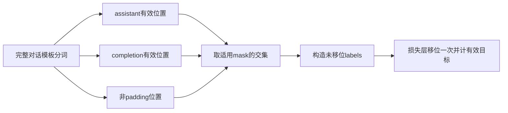
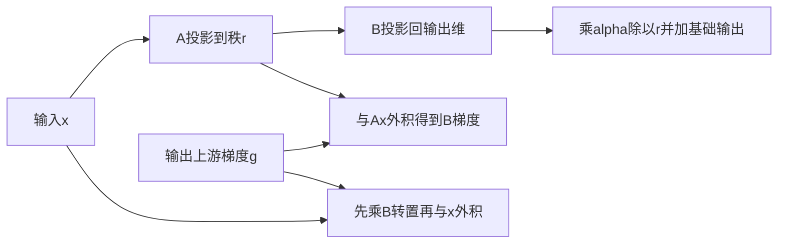
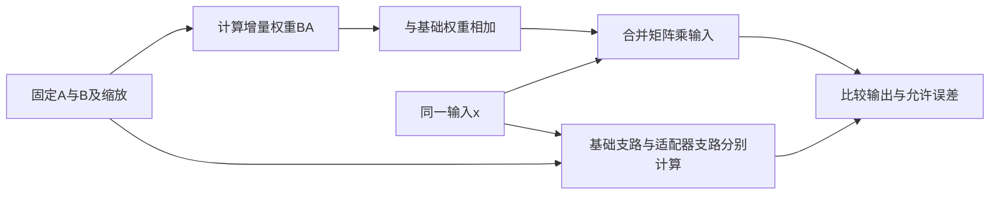

# 监督微调与LoRA

SFT 规定“学习哪些示范输出”，LoRA 规定“用哪些参数表达更新”。两者是不同维度：SFT 可以全参数训练或使用 LoRA；LoRA 也可用于其他训练目标。正确实施需同时核对监督位置、低秩梯度和推理时的适配器状态，不能只观察可训练参数数量。[InstructGPT 示范数据与SFT](https://arxiv.org/html/2203.02155v1#S3) [LoRA 低秩更新](https://arxiv.org/html/2106.09685v2#S4.SS1)

前置学习：[预训练目标与数据](预训练目标与数据.md)。完整示例：[sft.py](../../examples/training/sft.py)。

## 学习目标

- 根据完整对话的 token 位置构造 assistant/completion/padding 的监督交集。
- 推导 LoRA 对 A/B 的梯度，解释零 B 初始化何以仍能开始学习。
- 证明单个普通浮点适配器合并的前向等价，并列出 dropout、量化和多适配器的边界。

## 前置知识

需要下一 token 标签错位、交叉熵和矩阵链式法则。本文基础权重 $W_0\in\mathbb R^{d\times k}$ ，输入 $x\in\mathbb R^k$ ，A 为 `[r,k]`，B 为 `[d,r]`；注意 B 这里是低秩矩阵而非 batch。所有教学矩阵按输出维在前的约定存储。

## 基本机制

SFT 使用示范数据拟合条件输出，通常保留提示供模型读取，仅对选定回复计算损失；是否如此必须由具体模板、label 与训练器确认。该版本 TRL 在 `_prepare_dataset` 构建文本 labels，已有 labels 则保留；文本 collator 主要做 padding 和打包相关处理。不能按旧版本经验只把 mask 字段传给 collator 就假定监督正确。[TRL 标签生成与跳过准备保护](https://github.com/huggingface/trl/blob/1117c3b9c1632ee9814c30f6c9fc884b792a54e5/trl/trainer/sft_trainer.py#L1455-L1482)

## 推导或示例

### 知识点一：对话模板、mask交集与目标错位

**问题与机制。** 一条多轮对话中，到底哪些字符或 token 在训练模型“回答”？设完整模板分词得到 $u_0,\ldots,u_{T-1}$ ，assistant 标记为 $a_i$ 、所选 completion 为 $c_i$ 、真实非 padding 位为 $p_i$ 。若三项都适用，监督位为 $m_i=a_ic_ip_i$ 。未移位 label 为 $\ell_i=u_i$ （ $m_i=1$ ）或 ignore；对因果模型真正参与的项是

$$
L_{SFT}=-\frac1{\sum_{i=1}^{T-1}m_i}\sum_{i=1}^{T-1}m_i\log p_\theta(u_i\mid u_{\lt i}).
$$

位置 i 的 token 由位置 i-1 的 logits 预测。只对 assistant 监督与只对最后 completion 监督不等价：多轮历史里的旧 assistant 回复可能满足前者而不满足后者。是否训练角色边界和 EOS，应以模板给出的实际 mask 为准。[TRL tokenize_fn 与 build_labels](https://github.com/huggingface/trl/blob/1117c3b9c1632ee9814c30f6c9fc884b792a54e5/trl/trainer/sft_trainer.py#L1362-L1475) [因果损失内部错位](https://github.com/huggingface/transformers/blob/50e35cc0ca18ec19b80653690de553e6decf74f5/src/transformers/loss/loss_utils.py#L63-L72)

```python
def build_sft_labels(token_ids, assistant_mask, completion_mask=None, attention_mask=None):
    """用适用mask交集构造未移位labels，并列出下一token有效目标位置。"""
    if not token_ids:
        raise ValueError("token序列不能为空")
    masks = [assistant_mask]
    masks += [m for m in (completion_mask, attention_mask) if m is not None]
    if any(len(m) != len(token_ids) or any(x not in (0, 1, False, True) for x in m) for m in masks):
        raise ValueError("所有mask须为同长二值序列")
    labels = [token if all(m[i] for m in masks) else -100 for i, token in enumerate(token_ids)]
    targets = [i for i in range(1, len(labels)) if labels[i] != -100]
    return {"labels": labels, "target_positions": targets,
            "prediction_pairs": [(i - 1, labels[i]) for i in targets]}
```

代码接收已经分词且已经对齐的标记，不猜角色分隔符。输入 `[10,20,30,31,0]`，assistant mask 为 `[0,0,1,1,1]`，attention mask 为 `[1,1,1,1,0]`，得到 labels `[-100,-100,30,31,-100]`。有效目标在2与3，分别由 logits1和2预测。若 token31 是真实 EOS，保留监督；最后的0是 padding 才屏蔽，即使二者在某 tokenizer 中复用相同 ID，也需按位置区分。

模板边界还有一个常见陷阱：单独分词 prompt 的 token 序列不一定是分词 prompt+completion 的前缀，文本拼接处可能合并 token。该版本 TRL 使用最长公共前缀定位 completion，并在不一致时告警；字符长度不是可靠 token 边界。对话格式错误导致重复角色标签时，应先查这个边界和停止符，再讨论 LoRA 秩是否不足。



**源码定位。** 该版本 `build_labels` 以 `all(bits)` 求交集；collator 在 padding 时使用 -100。若跳过数据准备，仅有 mask 没有 labels，`_reject_skip_prepare_without_labels` 会拒绝，避免对全序列误训练。[TRL build_labels](https://github.com/huggingface/trl/blob/1117c3b9c1632ee9814c30f6c9fc884b792a54e5/trl/trainer/sft_trainer.py#L1469-L1482) [TRL 跳过准备时的标签保护](https://github.com/huggingface/trl/blob/1117c3b9c1632ee9814c30f6c9fc884b792a54e5/trl/trainer/sft_trainer.py#L1546-L1565) SFT 示范学习的研究依据见 [InstructGPT 监督训练步骤](https://arxiv.org/html/2203.02155v1#S3)。

**条件与反例。** 示例不会验证输入 mask 是否真的来自正确模板，只能检查长度和二值性；全零 mask 返回无有效目标，后续损失必须拒绝或过滤，不能分母置一后假装有学习信号。label mask 不删除提示，后续回复仍应能读取正确上下文。

### 知识点二：低秩参数、缩放与零初始化梯度

**问题与机制。** 如果 B 初始化为零，LoRA 会不会没有梯度？普通 LoRA 前向为

$$
h=W_0x+sBAx,\qquad s=\alpha/r.
$$

新增参数数为 $r(k+d)$ ，基础权重仍存储但不更新。给定上游梯度 $g=\partial L/\partial h\in\mathbb R^d$ ，令 $v=Ax$ ，有

$$
\frac{\partial L}{\partial B}=s g v^T,\qquad
\frac{\partial L}{\partial A}=s(B^Tg)x^T.
$$

当 B=0、A 非零时， $\nabla_A L=0$ ，但 $Ax$ 可能非零，因而 $\nabla_B L$ 可以非零；B 更新后 A 才开始接收到非零梯度。如果把 A、B 都设为零，两个梯度都会为零，纯这条支路无法启动。[LoRA 参数化、缩放与初始化](https://arxiv.org/html/2106.09685v2#S4.SS1)

```python
def lora_gradients(x, a, b, upstream, alpha=1.0):
    """给定输出梯度，计算标准alpha/r LoRA的A/B梯度，不更新基础权重。"""
    rank, inputs, outputs = _dimensions(x, a, b, alpha)
    if len(upstream) != outputs:
        raise ValueError("上游梯度宽度不匹配")
    scale = alpha / rank
    ax = [sum(row[j] * x[j] for j in range(inputs)) for row in a]
    btg = [sum(b[i][j] * upstream[i] for i in range(outputs)) for j in range(rank)]
    grad_b = [[scale * upstream[i] * ax[j] for j in range(rank)] for i in range(outputs)]
    grad_a = [[scale * btg[i] * x[j] for j in range(inputs)] for i in range(rank)]
    delta = [scale * sum(row[j] * ax[j] for j in range(rank)) for row in b]
    return {"grad_a": grad_a, "grad_b": grad_b, "delta_output": delta,
            "trainable_parameters": rank * (inputs + outputs), "scale": scale}
```

取 $x=[1,2]$ 、 $A=[1,-1]$ 、 $B=[0,0]^T$ 、 $g=[1,-1]$ 、 $r=1,\alpha=2$ 。 $Ax=-1,s=2$ ，所以 $\nabla_B=[-2,2]^T$ ， $\nabla_A=[0,0]$ ，初始更新输出为零。函数返回这些量而不更新任何参数，便于独立核对链式法则。若损失换成平方误差，则先由预测与目标求 $g$ ，同一局部梯度公式仍适用。

对于 $d=k=4096,r=8$ ，低秩参数为65536，完整更新矩阵为16777216，比例是1/256。这里不含额外 bias、其他目标层和优化器状态；“可训练参数少”不代表基础模型权重、前向激活或输入梯度消失。冻结 $W_0$ 仍可能需要通过 $W_0^Tg$ 把梯度传回更早可训练层。



**源码定位。** 该版本 PEFT 构造 A 的 `Linear(in,r)` 与 B 的 `Linear(r,out)`，普通分支用 $\alpha/r$ ，rsLoRA 分支用 $\alpha/\sqrt r$ 。默认 Linear 初始化 A 为 Kaiming uniform、B为零，原论文陈述的是 Gaussian A；不要把论文初始化分布误写成此版本默认。[PEFT LoRA参数与缩放](https://github.com/huggingface/peft/blob/7d6315ae910bf62b6044a7ca917bccf5881f5e43/src/peft/tuners/lora/layer.py#L253-L281) [PEFT reset_lora_parameters](https://github.com/huggingface/peft/blob/7d6315ae910bf62b6044a7ca917bccf5881f5e43/src/peft/tuners/lora/layer.py#L359-L372)

**条件与反例。** 梯度推导针对无 dropout、无偏置、单适配器的普通 LoRA；DoRA 或其他变体需重新推导。保持 alpha 不变而增大 r 会改变 s，不能把效果差异只归因“容量更大”。比较时应同时记录秩、alpha、初始化、目标模块和有效训练 token。

### 知识点三：合并等价成立的精确条件

**问题与机制。** 为什么有的 LoRA 推理可以消去适配器支路，有的不能直接合并？在普通线性层、固定 A/B、无 dropout 时，分配律给出

$$
W_0x+sB(Ax)=(W_0+sBA)x.
$$

因此可预先构造 $W_{merged}=W_0+sBA$ 。这是前向代数等价，不是声明任何量化方案、任意精度或多适配器调度都有零开销。两边浮点运算顺序不同，也可能产生小误差。[LoRA 合并推理讨论](https://arxiv.org/html/2106.09685v2#S4.SS1)

```python
def lora_merge_equivalence(weight, a, b, x, alpha=1.0):
    """比较未合并与显式合并的单适配器前向，不修改任何输入矩阵。"""
    rank, inputs, outputs = _dimensions(x, a, b, alpha)
    if len(weight) != outputs or any(len(row) != inputs for row in weight):
        raise ValueError("基础权重须为[out,in]")
    scale = alpha / rank
    delta = [[scale * sum(b[i][k] * a[k][j] for k in range(rank))
              for j in range(inputs)] for i in range(outputs)]
    merged = [[weight[i][j] + delta[i][j] for j in range(inputs)] for i in range(outputs)]
    ax = [sum(row[j] * x[j] for j in range(inputs)) for row in a]
    separate = [sum(weight[i][j] * x[j] for j in range(inputs))
                + scale * sum(b[i][k] * ax[k] for k in range(rank)) for i in range(outputs)]
    combined = [sum(row[j] * x[j] for j in range(inputs)) for row in merged]
    return {"delta_weight": delta, "merged_weight": merged, "separate": separate,
            "combined": combined, "max_error": max(abs(u - v) for u, v in zip(separate, combined))}
```

函数按 `[out,in]` 构造 $\Delta W$ 与新矩阵，返回分支计算和合并计算，不修改原输入。取单位 $W_0$ 、 $A=[1,-1]$ 、 $B=[0.5,-0.5]^T$ 、 $\alpha=2,r=1$ ，有 $\Delta W=[[1,-1],[-1,1]]$ ，合并权重 `[[2,-1],[-1,2]]`。输入 `[1,2]` 时，两种前向都得到 `[0,3]`。这比只比较权重 shape 更能检查转置和缩放是否正确。

如果训练时适配器先对 x 做随机 dropout，支路变为 $sBA(Dx)$ ，基础分支仍是 $W_0x$ 。一般无法用一个与随机 D 无关的固定合并权重对所有掩码保持等价。推理关闭 dropout 后才能使用上式。再次合并同一个 adapter 会把增量加两遍，因此生产实现还需记录 merged 状态；反复低精度加减也可能累积舍入误差。



**源码定位。** 该版本 `Linear.get_delta_weight` 计算 `transpose(B@A,fan_in_fan_out)*scaling`；`Linear.forward` 已合并时只走基础层，未合并时累加适配器支路。`merge(safe_merge=True)` 还会在副本上做有限值检查，这只检查数值有效性，不证明任务质量。[PEFT get_delta_weight 与 forward](https://github.com/huggingface/peft/blob/7d6315ae910bf62b6044a7ca917bccf5881f5e43/src/peft/tuners/lora/layer.py#L1138-L1209) [PEFT Linear.merge](https://github.com/huggingface/peft/blob/7d6315ae910bf62b6044a7ca917bccf5881f5e43/src/peft/tuners/lora/layer.py#L1059-L1102)

**条件与反例。** 示例只针对普通浮点线性权重，未涉及量化重打包、多个 adapter 混用、共享权重或分布式分片。相同输入时输出一致只是局部正确性；SFT 数据偏差、遗忘和独立任务质量仍需要评估。合并后若忘记停用适配器支路，也会重复加增量，应以执行路径状态而非文件名判断。

## 适用条件与限制

SFT 的低训练损失可能来自模板泄漏、答案记忆或分布过窄。LoRA 限制的是更新矩阵秩，不自动修复数据和偏好偏差，也不直接等价于奖励学习。论文效果和维护者版本的实现行为在本文分别注明，未声称复现了 InstructGPT 或 LoRA 的完整实验。

## 实践任务

交付两条多轮对话的位置/label表、一份零B与双零初始化的梯度表、一个合并前后输出对照。先固定模板与数据，再设计不同秩的比较；不要同时修改学习率和监督位置。全部教学验证由主 agent 常驻 UT 管理，本组未运行；真实适配器训练和量化合并仍保持已设计。

## 掌握标准

能指出首个回复 token 由哪一个位置预测；能解释 mask 交集和字符/token边界差异；能手算 A/B 梯度并说明初始 A 梯度为零；能用具体矩阵证明合并等价并列出失效条件。只会计算参数比例，尚不足以判断一个 adapter 是否训练和加载正确。

## 源码与后续阅读

本页引用固定版 InstructGPT、LoRA 原论文，PEFT 与 TRL 具体提交，以及 Transformers 标签移位实现。未独立复现全参数或低秩微调任务质量。关联阅读：[偏好学习与DPO](偏好学习与DPO.md)。

## 2026研究进展

ACL 2026的样本极性研究讨论正、负rollout及token级优势塑形。SFT中的“模仿正确标签”与RL中的“降低负优势动作概率”并不相同，因此不能把错误轨迹直接当作SFT正例来吸收负样本。 [会议来源与读取范围](../../sources/library/2026-paper-training-polarity/README.md)

更多公式、代码示例、结构图及当前开源版本见[训练研究进展](../frontiers/训练研究进展.md)。新内容未执行真实模型实验。

---

[返回模块](../modules/训练.md) · [知识点索引](../../docs/知识点索引.md) · [完整教学代码](../../examples/training/sft.py) · [提出更正](https://github.com/yanbozhang/llm-systems-wiki/issues/new?template=knowledge.yml)

觉得这篇推导有帮助，可以在 [GitHub](https://github.com/yanbozhang/llm-systems-wiki) 点 Star 收藏更新；分享时欢迎链接到具体知识点，便于读者复核公式、代码与来源。
