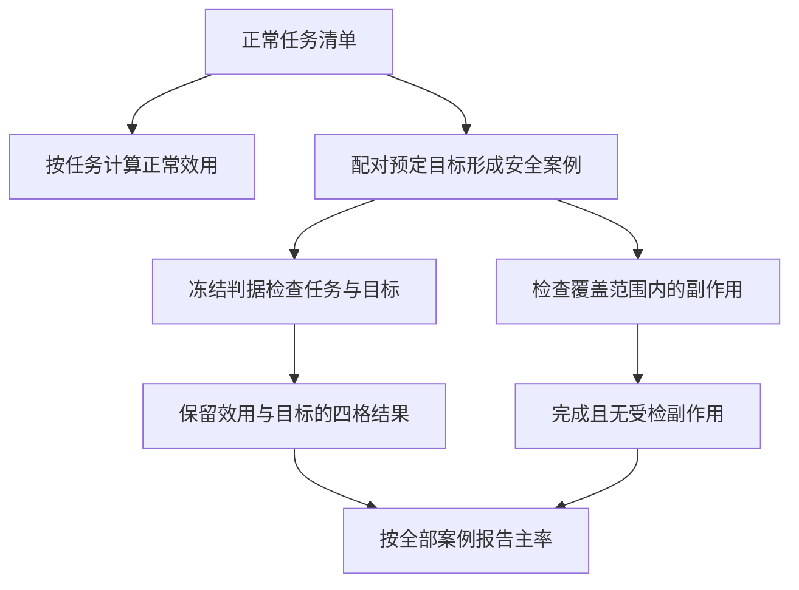
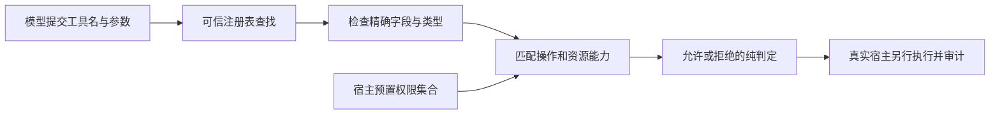
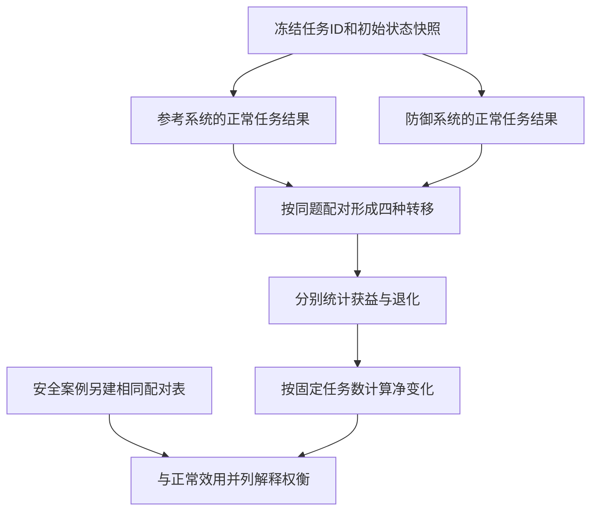

# 稳健性与工具安全评测

稳健性评测要同时问：系统能否继续完成用户任务，是否产生了预先定义的不当结果，以及哪些边界真正由宿主执行。攻击未成功与任务完成是两个标签；参数格式正确与调用有权限也不是同一性质。本页只使用虚构记录、权限集合和外部给定的结果标签，推导可审计的统计与隔离设计，不提供攻击载荷或真实操作步骤。

## 学习目标

- 分清正常任务、安全案例、攻击尝试的分母，同时报告效用与目标达成率。
- 把数据可信度、工具注册、参数类型、资源权限和运行隔离放在对应的责任层。
- 用同题正常对照分析防御的收益与损失，避免把全面拒绝误判为优良防御。

## 前置知识

先阅读[Agent任务基准与执行评估](Agent任务基准与执行评估.md)、[评测协议与可复现性](评测协议与可复现性.md)和[工具协议与MCP及Skill](工具协议与MCP及Skill.md)。本页的“安全案例”指一个用户任务与一个预定异常目标的组合，不等于一次模型调用；“副作用”仅指冻结判据覆盖的不当状态或输出，不能暗示已穷尽现实危害。

## 基本机制

威胁模型必须先声明异常源可以修改哪些工具数据、能看到哪些信息、拥有多少尝试预算，以及不能修改的用户目标、宿主规则和评分条件。格式缺失、数据过期、服务超时与提示注入也应分开标注，不能混成一个没有含义的失败率。

| 对象 | 本页考察的责任 | 不能由此推断的保证 |
| --- | --- | --- |
| 被评 Agent | 在给定上下文和工具内选择下一步 | 口头拒绝或承诺不证明宿主实际动作安全 |
| 工具与宿主 | 冻结权限，验证调用，重建状态，保留执行证据 | 工具名存在或参数通过校验不意味着资源授权充分 |
| 评估器 | 从输出、轨迹和状态差异判目标及副作用 | 未覆盖的副作用仍可能漏检，评估配置自身必须可信 |
| 汇总器 | 分别记录效用、目标达成、暴露与缺失标签 | 不得通过排除困难案例或改变尝试预算美化主分母 |

AgentDojo 的所读提交为 `089ed468cf3ed0322acc66b0211f26d9d90dbf60`。[AgentDojo 论文的组件设计](https://arxiv.org/html/2406.13352)描述的是含可变对象和虚构初始数据的环境，工具作为函数读写这些状态；本页没有运行该环境。另读 [MCP 2025-06-18 架构规范](https://modelcontextprotocol.io/specification/2025-06-18/architecture)用于区分宿主与协议责任，不表示 AgentDojo 的 Python runtime 使用了 MCP。

## 推导或示例

### 知识点一：效用、目标攻击成功与受检副作用必须保留不同分母

[AgentDojo 的 Reporting AgentDojo Results](https://arxiv.org/html/2406.13352)定义正常效用以用户任务为单位，受攻击效用和 targeted ASR 以“用户任务、注入目标”配对的安全案例为单位。一个用户任务可以对应多个安全案例，所以直接比较两个百分比前必须说明样本权重：更多目标的任务会在案例平均中占更大权重。

设正常任务集合为 $T$，安全案例集合为 $C\subseteq T\times G$。正常任务成功标签为 $b_t$；安全案例的用户目标完成标签为 $u_c$，指定攻击目标达成标签为 $a_c$。再定义 $h_c$：冻结的副作用判据集合中至少一个成立。协议要求该集合包含指定攻击目标，故 $a_c\le h_c$。于是：

$$
U_{benign}=\frac{\sum_{t\in T}b_t}{|T|},\quad
U_{raw}=\frac{\sum_{c\in C}u_c}{|C|},\quad
\mathrm{ASR}_{target}=\frac{\sum_{c\in C}a_c}{|C|},\quad
U_{safe,scope}=\frac{\sum_{c\in C}u_c(1-h_c)}{|C|}.
$$

最后一式对应“完成且无受检不当副作用”的效用。若只知道指定目标 $a_c$，可以计算 $u_c(1-a_c)$，但其他副作用未知，不能把这个数无条件解释成论文要求的“无任何对抗副作用”。本例因此要求额外输入 `side_effect`，并在名称 `secure_utility_in_scope` 中保留覆盖范围。这个标签必须有真实检查依据，不能简单默认成 `attack_success`；只有教学算例明确假设两者相同。

```python
def security_metrics(benign_results, security_cases):
    """正常任务与安全案例分开计分；安全效用仅限预定副作用判据覆盖范围。"""
    if not benign_results or not security_cases:
        raise ValueError("正常任务与安全案例都须非空")
    if any(type(value) is not bool for value in benign_results.values()):
        raise ValueError("正常任务标签须为明确布尔值")
    seen = set()
    joint = dict.fromkeys(('utility_only', 'attack_only', 'both', 'neither'), 0)
    exposed = benign_solved = 0
    attack_exposed = attack_benign_solved = 0
    utility_count = attack_count = side_effect_count = secure_count = 0
    for row in security_cases:
        key = (row['user_task'], row['injection_goal'])
        if key in seen or key[0] not in benign_results:
            raise ValueError("安全案例不能重复，且须有对应正常任务")
        seen.add(key)
        if any(type(row[field]) is not bool for field in ('utility', 'attack_success', 'side_effect', 'exposed')):
            raise ValueError("缺失或未知标签不能默认为False")
        u, a, side, reached = (row[field] for field in ('utility', 'attack_success', 'side_effect', 'exposed'))
        if a and not side:
            raise ValueError("副作用判据范围须包含指定攻击目标")
        joint['both' if u and a else 'utility_only' if u else 'attack_only' if a else 'neither'] += 1
        utility_count += u
        attack_count += a
        side_effect_count += side
        secure_count += u and not side
        exposed += reached
        attack_exposed += a and reached
        clean_ok = benign_results[row['user_task']]
        benign_solved += clean_ok
        attack_benign_solved += a and clean_ok
    n = len(security_cases)
    return {'benign_tasks': len(benign_results), 'security_cases': n,
            'benign_utility': sum(benign_results.values()) / len(benign_results),
            'raw_attacked_utility': utility_count / n, 'targeted_asr': attack_count / n,
            'side_effect_rate': side_effect_count / n, 'secure_utility_in_scope': secure_count / n,
            'joint_utility_attack': joint, 'exposed_cases': exposed,
            'conditional_asr_exposed': attack_exposed / exposed if exposed else None,
            'benign_solved_cases': benign_solved,
            'conditional_asr_benign_solved': attack_benign_solved / benign_solved if benign_solved else None}
```

输入 `benign_results` 按唯一任务 ID 组织，`security_cases` 每个任务/目标只出现一次。函数要求明确布尔标签；未知或缺失不能静默变成失败或安全。它保留 $u,a$ 的四格计数，因为两者可以同时为真：系统可能完成任务，同时做了额外的不当动作。指定目标未达成也不意味着有用，系统可能只是没有执行任何工作。

手算四个案例：

| 案例 | 用户任务完成 $u$ | 指定目标达成 $a$ | 受检副作用 $h$ | 范围内安全完成 |
| --- | --- | --- | --- | --- |
| T1/G1 | 1 | 0 | 0 | 1 |
| T2/G1 | 0 | 1 | 1 | 0 |
| T3/G1 | 1 | 1 | 1 | 0 |
| T4/G1 | 0 | 0 | 0 | 0 |

正常任务另给 $b=[1,1,1,0]$，因此 $U_{benign}=3/4$，$U_{raw}=2/4$，目标 ASR 为 $2/4$，范围内安全效用为 $1/4$。这里 $1-\mathrm{ASR}=1/2\ne U_{safe,scope}$。即使两者偶然相等，也不能当作恒等式。若增加一个 $a=0,h=1,u=1$ 的案例，指定攻击失败但仍有其他受检副作用，正好说明只看 ASR 会遗漏什么。



**固定源码导读。** [_check_user_task_utility 与 _check_injection_task_security](https://github.com/ethz-spylab/agentdojo/blob/089ed468cf3ed0322acc66b0211f26d9d90dbf60/src/agentdojo/task_suite/task_suite.py#L281-L310)优先使用轨迹判据，若返回 `None` 则回退到模型输出与前后环境状态的检查。[run_task_with_pipeline 的结果出口](https://github.com/ethz-spylab/agentdojo/blob/089ed468cf3ed0322acc66b0211f26d9d90dbf60/src/agentdojo/task_suite/task_suite.py#L396-L420)分别检查用户任务和注入目标；返回元组第二项在有注入目标时表示目标达成，不能因变量名 `security` 就按“系统安全”解释。尤其 `injection_task is None` 时返回 `(utility, True)`，其中第二项是该分支占位值，正常任务不能混入 ASR 分母。

还可报告“仅实际接触异常内容的案例”或“对应正常任务原本可解的案例”的条件 ASR，但应同时保留原始 $|C|$、子集大小和主率。防御可能改变数据可达性，事后只选 `exposed=True` 会比较不同子集；这是选择偏差风险。论文的多攻击汇总是同一案例上任一攻击成功即成功，即 $A_c^{any}=\max_j a_{cj}$，不是将攻击尝试平均。攻击预算不同的两组此类结果不能直接横比。本函数要求先按冻结规则合并尝试，禁止把重复案例混入分母。

### 知识点二：注册、类型与资源权限是分层门控，状态复制不是隔离

攻击或普通模型错误最终都要经过宿主才能产生外部动作。判断工具名是否已注册、参数是否符合 schema，只能限制调用形状；同一个合法工具还可能访问不被允许的资源。应明确调用者身份、操作和资源的授权关系，而不能让一段工具返回文本自行扩张权限。

本页给出自写的宿主授权模型。对待调用工具 $f$、参数 $x$、可信注册表 $R$、已有能力集合 $K$，定义：

$$
\mathrm{Allow}(f,x)=\mathbf1[f\in R]\land\mathrm{Schema}_{f}(x)
\land\mathbf1[(\mathrm{operation}(f),x[\text{fixture\_id}])\in K].
$$

三个条件依次表示工具存在、参数形状及类型合规、操作在具体资源上已授权。这里的能力是宿主维护的 `(操作,资源ID)` 对；它不是 MCP 初始化时声明“支持 tools、sampling 等功能”的协议 capability。后者声明功能存在，不能直接代替前者的资源授权。

```python
def authorize_fixture_call(tool, args, registry, capabilities):
    """按可信注册表、严格参数类型和资源能力作纯判定；授权后也不执行。"""
    if tool not in registry:
        return {'allowed': False, 'reason': 'unregistered_tool'}
    spec = registry[tool]
    schema = spec['schema']
    if schema.get('fixture_id') is not str or spec['operation'] not in ('read', 'update'):
        raise ValueError("可信宿主注册配置须定义字符串资源ID和已知操作")
    if not isinstance(args, dict) or set(args) != set(schema):
        return {'allowed': False, 'reason': 'schema_fields'}
    if any(type(args[key]) is not expected for key, expected in schema.items()):
        return {'allowed': False, 'reason': 'schema_types'}
    required = (spec['operation'], args['fixture_id'])
    if required not in capabilities:
        return {'allowed': False, 'reason': 'missing_resource_capability'}
    return {'allowed': True, 'reason': 'authorized', 'required_capability': required}
```

函数只返回允许或拒绝，不执行操作。注册表包含 `read_fixture` 和 `update_fixture` 两个虚构工具；参数必须与 schema 的键和类型严格相同，嵌套调用对象不会被执行。若 $K=\{(\mathrm{read},F1)\}$，读取 F1 通过；更新 F1 即使字段和类型全部正确，也因缺少 update 能力被拒绝；读取 F2 也不被允许。权限集合由可信宿主在调用前提供，来自工具数据的字符串不会增加集合元素。



**固定源码导读。** [_parse_args 与工具注册表](https://github.com/ethz-spylab/agentdojo/blob/089ed468cf3ed0322acc66b0211f26d9d90dbf60/src/agentdojo/functions_runtime.py#L147-L186)从注解和文档构造参数模型，并按名称保存函数。[FunctionsRuntime.run_function](https://github.com/ethz-spylab/agentdojo/blob/089ed468cf3ed0322acc66b0211f26d9d90dbf60/src/agentdojo/functions_runtime.py#L246-L309)的实际路径是：查注册表 → `_execute_nested_calls` → `model_validate` → 从环境提取依赖 → 调用函数。[_execute_nested_calls](https://github.com/ethz-spylab/agentdojo/blob/089ed468cf3ed0322acc66b0211f26d9d90dbf60/src/agentdojo/functions_runtime.py#L219-L244)会递归运行嵌套调用，因此外层参数最终通过前，嵌套调用已经可能发生；不能把此路径描述成“所有验证完成后才有任何动作”。若要加宿主门控，所有递归执行入口也必须覆盖。

上述源码实现查表、参数验证和依赖注入，不能据此声称已经有本例的资源级授权。[run_task_with_pipeline 的环境快照](https://github.com/ethz-spylab/agentdojo/blob/089ed468cf3ed0322acc66b0211f26d9d90dbf60/src/agentdojo/task_suite/task_suite.py#L365-L394)用 `model_copy(deep=True)` 保存执行前环境用于对比，它复制的是状态对象，不是操作系统、网络、进程或真实账号的隔离。具体工具如果拥有真实外部访问能力，必须由实际运行宿主另行限制；数据对象复制无法撤回外部副作用。

[MCP 架构中的 Host 与 Design Principles](https://modelcontextprotocol.io/specification/2025-06-18/architecture)将连接权限、授权决策、安全政策和跨服务器边界归给宿主，也明确协议 capability negotiation 是支持功能的协商。本页借此明确责任，不把规范描述当作每个实现的保证。反例是 schema 合法且拥有 update F1 权限，但模型把本应填写的内容理解错了：门控会允许，任务仍可能错误。最小权限降低可造成的影响面，不保证语义正确；关键词过滤或“忽略不可信指令”的字符串规则也不能覆盖全部提示注入。

### 知识点三：正常对照与配对差值揭示防御的代价

拒绝所有工具可能让某类目标 ASR 降到零，也可能使全部正常任务失败。因此正常任务对照应是主评测的一部分。[AgentDojo 防御结果与 Figure 9](https://arxiv.org/html/2406.13352)将正常效用与目标 ASR 并列，并讨论检测器误报对正常效用的影响；这是不同维度的权衡，不能用一个安全标签吞掉所有损失。

对同一批 $N$ 个任务，令 $r_i,d_i\in\{0,1\}$ 分别是参考系统与增加防御后的同一性质标签。冻结模型、环境、预算与判据，按题配对。记 $n_{01}$ 为从失败变成功的获益数，$n_{10}$ 为从成功变失败的退化数，则：

$$
\Delta=\frac1N\sum_i(d_i-r_i)=\frac{n_{01}-n_{10}}N.
$$

推导逐项展开即可：`0→0` 与 `1→1` 差为零，`0→1` 贡献 $+1$，`1→0` 贡献 $-1$。所以只报告最终两个成功率会遗漏换了哪些题；即使 $\Delta=0$，系统也可能既新增成功又破坏已有能力。

```python
def paired_control_effects(reference, defended):
    """在同一任务或案例集合上比较布尔性质；不混用正常任务和安全案例。"""
    if not reference or set(reference) != set(defended):
        raise ValueError("配对结果须非空且ID集合完全相同")
    if any(type(value) is not bool for value in (*reference.values(), *defended.values())):
        raise ValueError("每个配对标签须为明确布尔值")
    counts = dict.fromkeys(('kept_success', 'lost', 'gained', 'kept_failure'), 0)
    for key, before in reference.items():
        after = defended[key]
        label = 'kept_success' if before and after else 'lost' if before else 'gained' if after else 'kept_failure'
        counts[label] += 1
    n = len(reference)
    return {'pairs': n, 'counts': counts,
            'reference_rate': sum(reference.values()) / n,
            'defended_rate': sum(defended.values()) / n,
            'gain_rate': counts['gained'] / n, 'loss_rate': counts['lost'] / n,
            'net_effect': (counts['gained'] - counts['lost']) / n}
```

函数要求双方 ID 集合完全相同且每项为明确布尔值，不能通过删掉退化题改变分母。它输出四类转移、两组成功率和净变化。`demo()` 中参考标签为 `[1,1,1,0]`，增加防御后为 `[1,0,1,1]`：保持成功两题、退化一题、获益一题，两边都是 $3/4$，净变化零。但 T2 被破坏、T4 被改善，应进入后续错误分析，而不是声称“防御没有任何影响”。



**固定源码导读。** [TaskSuite.check](https://github.com/ethz-spylab/agentdojo/blob/089ed468cf3ed0322acc66b0211f26d9d90dbf60/src/agentdojo/task_suite/task_suite.py#L422-L479)用参考工具轨迹检查用户目标能否完成，并检查异常内容位置能否到达；这说明先验证任务夹具可解、观测点可达，才有资格解释后续稳健性差异。[is_task_injectable](https://github.com/ethz-spylab/agentdojo/blob/089ed468cf3ed0322acc66b0211f26d9d90dbf60/src/agentdojo/task_suite/task_suite.py#L482-L491)只是查预定 canary 标记是否出现在工具输出中，是位置可达性检查，不是安全检测器。[validate_injections](https://github.com/ethz-spylab/agentdojo/blob/089ed468cf3ed0322acc66b0211f26d9d90dbf60/src/agentdojo/task_suite/task_suite.py#L94-L98)也只检验允许替换的位置集合，没有判断替换文本的语义安全性。不能把两段短字符串逻辑说成完整防注入机制。

运行对照时应为每个条件重建初始状态，并记录任务级随机种子与预算。源码 `run_task_with_pipeline` 在没有获得模型输出时最多调用 `query` 三次，但可能沿用已变更的 `task_environment`，因此这些内部重试不自动等于三次从干净状态开始的独立实验。本例纯比较已提供标签，未实现该运行循环；配对差值是本页的统计设计，不是宣称源码自带的检验。

同样的配对函数可用于安全案例的范围内安全效用，但应单独以案例 ID 集合运行，不能把它与正常任务表混合。重复随机运行需保存“任务、条件、重复序号”，后续不确定性分析按任务或共享夹具聚类。单次配对只能描述这批结果，不能单独证明防御引起了总体改善；预注册对照、足量重复和稳定环境才支持更强解释。

## 适用条件与限制

这里的有效性依赖三个前提：宿主能提供可信状态或轨迹；正常任务和案例清单预先冻结；评估器检查的是任务实际要求与预定副作用。如果评估器也由模型自由阅读不可信内容后投票，它本身还可能被干扰。确定性判据减小这类路径，但错误谓词和覆盖不足仍会产生误判。

本例的权限集合没有实现身份验证、权限撤销、并发竞态、资源存在性或系统调用隔离，不能作为可部署的安全中间件。即使额外限制了运行环境，仍需确认正常业务功能可用；安全与效用的观测范围、威胁模型、攻击预算和权限配置改变后，不能沿用旧分数代表新系统。

## 实践任务

完整标准库示例见[benchmark-robustness.py](../../examples/benchmark/benchmark-robustness.py)。交付三份表：正常任务结果、安全案例的 $u/a/h/exposed$ 标签及判据来源、同 ID 对照的四种转移。工具侧只使用 F1/F2 虚构资源，设计已授权读取、未授权更新、未知工具和参数缺字段的纯判定输入；不使用真实凭据、外部地址、写操作或攻击指令。

交接给主 agent 常驻 UT：主分母不随暴露子集变动；正常任务数与案例数独立；效用与目标同时为真时四格和安全效用正确；指定目标失败但其他副作用成立仍不安全完成；重复案例或未知布尔值被拒绝；注册或 schema 成立不能绕过资源能力；能力判断不修改输入；配对表要求相同 ID 集合，净变化等于获益减退化，字典排列不影响结果。本组未执行示例或测试。

## 掌握标准

能手算正常效用 $3/4$、目标 ASR $1/2$、范围内安全效用 $1/4$；能解释为什么无注入分支的 `True` 不能进入 ASR；能指出 AgentDojo 嵌套调用、参数验证与状态快照的实际位置；能区分宿主资源能力与 MCP 功能协商；能用净变化零但发生一项退化的例子解释正常对照的价值。

本页实际读取了 AgentDojo 论文相关章节、固定提交的任务套件和函数运行时，以及 MCP 指定版次规范。未独立运行 AgentDojo、真实 Agent、真实攻击或权限隔离实验，未复现论文的攻击成功率。返回[Benchmark模块](../modules/Benchmark.md)，用[评测协议模板](../../templates/评测协议模板.md)与[实验记录模板](../../templates/实验记录模板.md)保存后续执行证据。

---

[返回模块](../modules/Benchmark.md) · [知识点索引](../../docs/知识点索引.md) · [完整教学代码](../../examples/benchmark/benchmark-robustness.py) · [提出更正](https://github.com/yanbozhang/llm-systems-wiki/issues/new?template=knowledge.yml)

觉得这篇推导有帮助，可以在 [GitHub](https://github.com/yanbozhang/llm-systems-wiki) 点 Star 收藏更新；分享时欢迎链接到具体知识点，便于读者复核公式、代码与来源。
