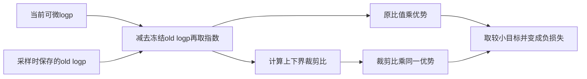
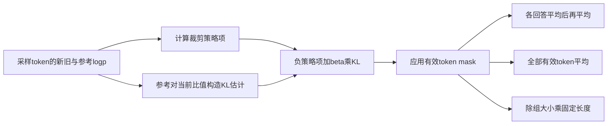

# 策略优化与GRPO

GRPO 把同题多条采样回答的相对奖励转为优势，再用新旧策略概率比优化这些已采样 token。它省去独立价值模型，并不省去奖励定义、采样预算、旧策略或参考约束的管理。本页按 outcome supervision 推导三个数值单元，并与固定提交下的 TRL 分支对照。[DeepSeekMath 的GRPO机制](https://arxiv.org/html/2402.03300v3#S4.SS1)

前置学习：[偏好学习与DPO](偏好学习与DPO.md)。完整示例：[policy-optimization.py](../../examples/training/policy-optimization.py)。

## 学习目标

- 算清组内优势的样本/总体标准差、零方差和缺失评分边界。
- 根据优势符号判断裁剪哪一侧会饱和，并解释概率比为一时仍可能有梯度。
- 区分 KL 估计的非负值与期望无偏条件，核算不等长回复的三种损失归约。

## 前置知识

同一提示记为 q，回答组大小为 G，第 i 个回答有效长度为 $T_i$。当前策略 $\pi_\theta$ 接收梯度；旧策略 $\pi_{old}$ 提供本批生成概率；参考策略 $\pi_{ref}$ 提供约束锚点。old 与 ref 即使某一时刻权重相同，也承担不同角色。奖励 $r_i$ 由规则或模型给出，不是语言模型的 token 概率。

## 基本机制

DeepSeekMath 的原始组目标对每个回答内 token 求平均，再对组内回答平均，包含裁剪优势项与 KL 项；其算法还区分更新旧策略、采样、评分和多次策略更新。TRL 同名 Trainer 包含 `grpo`、`bnpo`、`dr_grpo` 等归约，配套文档也明确列出与论文的变化。本文显式指定分支，不把当前工具的默认配方当成原论文定义。[DeepSeekMath 算法1与目标式](https://arxiv.org/html/2402.03300v3#S4.SS1.SSS1) [TRL GRPO机制与loss类型](https://github.com/huggingface/trl/blob/1117c3b9c1632ee9814c30f6c9fc884b792a54e5/docs/source/grpo_trainer.md)

## 推导或示例

### 知识点一：组内基线、标准差约定与无区分信号

**问题与机制。** 奖励 `[0,0,1,1]` 的优势到底是正负1，还是正负0.866？两种数值来自不同标准差约定。令有效评分数为 N、自由度修正为 $\delta$，定义

$$
\bar r=\frac1N\sum_ir_i,\quad
s_\delta=\sqrt{\frac{\sum_i(r_i-\bar r)^2}{N-\delta}},\quad
A_i=\frac{r_i-\bar r}{s_\delta+\epsilon}.
$$

$\delta=0$ 为总体标准差，$\delta=1$ 为样本标准差。上述奖励均值0.5，总体标准差0.5；忽略 epsilon 时优势为 `[-1,-1,1,1]`。样本标准差为 $\sqrt{1/3}$，优势为 $[-\sqrt3/2,-\sqrt3/2,\sqrt3/2,\sqrt3/2]$。公式里的 std 不写约定，教学值就无法与实现精确对齐。[DeepSeekMath 结果监督的组内优势](https://arxiv.org/html/2402.03300v3#S4.SS1.SSS2)

```python
def group_advantages(rewards, ddof=1, eps=1e-4):
    """同一提示的组内优势；None表示无法评分，明确排除而非当零奖励。"""
    if not rewards or ddof not in (0, 1) or not math.isfinite(eps) or eps <= 0:
        raise ValueError("奖励须非空、ddof为0或1、epsilon为有限正数")
    valid = [r for r in rewards if r is not None]
    if any(not math.isfinite(r) for r in valid):
        raise ValueError("奖励须有限；缺失请使用None")
    if not valid:
        return {"mean": None, "std": 0.0, "advantages": [0.0] * len(rewards), "valid_count": 0}
    mean = sum(valid) / len(valid)
    variance = sum((r - mean)**2 for r in valid) / (len(valid) - ddof) if len(valid) > ddof else 0.0
    std = math.sqrt(variance)
    return {"mean": mean, "std": std, "advantages": [0.0 if r is None else (r - mean) / (std + eps) for r in rewards],
            "valid_count": len(valid)}
```

该函数默认 `ddof=1,eps=1e-4`，与所读 TRL `nanstd` 的 Bessel 修正和优势分母中的小量对应。缺失评分用 None 显式表示并排除，不能把“无法评分”当作真实奖励0，否则会改变其他回答的组基线。全部缺失时返回零优势和空均值；只有一个有效评分时也给零优势。这是教学边界约定，生产实现经 NaN 处理到零优势的中间过程不同。

所有奖励相等时分子为零，无论“全部答对”还是“全部答错”，组内相对信号都没有区分度。若每个回答独立以概率 p 得到二值奖励1，则组内非退化的概率为 $1-p^G-(1-p)^G$。当 $p=0.5,G=4$，有7/8的概率同时出现0和1；p 接近0或1时更容易退化。此概率是独立伯努利教学模型，不是实际语言模型采样一定独立的质量预测。


**源码定位。** 该版本 `nanstd` 先求均方偏差，再乘 `count/(count-1)`；`_generate_and_score_completions` 在 `sum_then_normalize` 路径加权奖励、求组均值、按组或批缩放，最后将 NaN 优势置零。[TRL nanstd 的Bessel修正](https://github.com/huggingface/trl/blob/1117c3b9c1632ee9814c30f6c9fc884b792a54e5/trl/trainer/utils.py#L1016-L1049) [TRL 奖励合并与优势处理](https://github.com/huggingface/trl/blob/1117c3b9c1632ee9814c30f6c9fc884b792a54e5/trl/trainer/grpo_trainer.py#L2797-L2857)

**条件与反例。** 一组必须对应同一提示，混入不同难度的问题会把题目差异当成回答差异。组内均值为零不保证样本估计无偏或所有题权重相同；标准差缩放本身会改变题目间更新幅度。过程奖励的每 token 优势可由后续步骤奖励累计，不能直接把这里的回答级常数广播公式用于全部过程监督。

### 知识点二：概率比裁剪的方向与冻结旧策略

**问题与机制。** clip 是否把所有更新都硬限制在同一范围？对一个采样 token，令

$$
\rho=\exp(\log\pi_\theta-\log\pi_{old}),\quad
f(\rho,A)=\min(\rho A,\operatorname{clip}(\rho,1-\varepsilon,1+\varepsilon)A),\quad
\ell=-f.
$$

若 A 为正，提升该 token 概率有利，$\rho>1+\varepsilon$ 后目标收益封顶；若 A 为负，降低其概率有利，$\rho<1-\varepsilon$ 后收益封顶。对会让目标恶化的一侧仍保留原项，因此 clip 不是把实际模型概率比强制截断到一个信任区间。[DeepSeekMath 裁剪目标式3](https://arxiv.org/html/2402.03300v3#S4.SS1.SSS1)

在非饱和区，$\partial\rho/\partial\log\pi_\theta=\rho$，所以 $\partial\ell/\partial\log\pi_\theta=-A\rho$；收益饱和的一侧为0。精确边界处是非光滑点，自动微分可能选择特定子梯度，不能用本页分段讨论保证全部框架在边界逐位一致。

```python
def clipped_surrogate(new_logp, old_logp, advantage, epsilon=0.2):
    """返回单token裁剪目标、负目标损失及非边界处对new_logp的导数。"""
    if not all(math.isfinite(x) for x in [new_logp, old_logp, advantage, epsilon]) or not 0 <= epsilon < 1:
        raise ValueError("输入须有限，epsilon须在[0,1)")
    try:
        ratio = math.exp(new_logp - old_logp)
    except OverflowError as exc:
        raise ValueError("概率比超出浮点范围") from exc
    clipped = min(max(ratio, 1 - epsilon), 1 + epsilon)
    objective = min(ratio * advantage, clipped * advantage)
    saturated = (advantage > 0 and ratio > 1 + epsilon) or (advantage < 0 and ratio < 1 - epsilon)
    return {"ratio": ratio, "objective": objective, "loss": -objective,
            "grad_new_logp": 0.0 if saturated else -advantage * ratio, "saturated": saturated}
```

令 $\varepsilon=0.2,\rho=1.5$。A=1时两项为1.5和1.2，取1.2，损失-1.2、局部梯度0；A=-1时两项为-1.5和-1.2，取-1.5，损失1.5，梯度1.5。把 `min` 错写成 `max` 会让正负两侧都失去保守目标含义。另取 $\rho=0.5,A=-1$，裁剪项-0.8更小，损失0.8且梯度0，展示负优势的饱和方向。

还有容易误判的一点：更新开始时 current 与 old 数值相同，$\rho=1$，但 old 被视为常量，因此梯度仍是 $-A$。若用可微的同一个 logp 同时作分子分母，则二者相消，梯度错误地变为0。数值相等与计算图相同不是同一件事。



**源码定位。** 该版本在缺少单独 old logp 的特定路径使用 `per_token_logps.detach()`；随后形成 `log_ratio`，token 级设置直接取其指数。在 `grpo` 等分支对两个乘积取 `torch.min`，再加负号。[TRL old策略detach及概率比](https://github.com/huggingface/trl/blob/1117c3b9c1632ee9814c30f6c9fc884b792a54e5/trl/trainer/grpo_trainer.py#L3107-L3142) [TRL 正负优势的裁剪实现](https://github.com/huggingface/trl/blob/1117c3b9c1632ee9814c30f6c9fc884b792a54e5/trl/trainer/grpo_trainer.py#L3159-L3167)

**条件与反例。** 示例对应 token 级重要性比、对称裁剪、固定优势，无额外 off-policy mask、采样器校正或双侧 delta。old 不能误替换成 reference；前者负责本批采样分布，后者负责长期约束。更新多步后仍拿当前概率当 frozen old，也会改变目标，需记录采样策略版本和刷新时机。

### 知识点三：KL估计的期望条件与不等长归约

**问题与机制。** 一个非负 token 罚项就等于整个策略的 KL 吗？令 $a=\log\pi_{ref}(y)-\log\pi_\theta(y)$，常见样本估计为

$$
k_3=e^a-a-1.
$$

由 $e^a\ge1+a$，它逐点非负。当 y 真正从当前策略采样，且参考与当前具有合适的共同支持时，

$$
\mathbb E_{y\sim\pi_\theta}k_3
=\sum_y\pi_{ref}(y)-1+
\mathbb E_{\pi_\theta}\log\frac{\pi_\theta(y)}{\pi_{ref}(y)}
=D_{KL}(\pi_\theta\|\pi_{ref}).
$$

所以“无偏”有采样分布条件。数据来自旧策略且模型已更新时，直接平均这个值不自动等于当前策略的 KL；按 token 条件分布做重要性修正还需正确的比值和支持集，状态/历史分布与梯度处理另有边界。[DeepSeekMath KL估计式4](https://arxiv.org/html/2402.03300v3#S4.SS1.SSS1)

把本知识点与前面的裁剪连接，逐 token 最小化项为 $\ell_{i,t}=-f(\rho_{i,t},A_i)+\beta k_{3,i,t}$。对有效 mask $m_{i,t}$，可以定义

$$
L_{seq}=\frac1G\sum_i\frac{\sum_tm_{i,t}\ell_{i,t}}{T_i},\quad
L_{token}=\frac{\sum_{i,t}m_{i,t}\ell_{i,t}}{\sum_iT_i},\quad
L_{const}=\frac{\sum_{i,t}m_{i,t}\ell_{i,t}}{G T_{max}}.
$$

三者分配不同的回答和 token 权重，不是同一标量的三种打印格式。示例返回三种归约，便于直接看到差别；它没有模拟分布式累积窗口的额外缩放。

```python
def grpo_loss_terms(new_logps, old_logps, reference_logps, advantages, masks,
                    epsilon=0.2, beta=0.1, max_completion_length=None):
    """按已采样token计算裁剪加KL，并返回序列、token和固定长度三种归约。"""
    batch = len(new_logps)
    if not batch or any(len(x) != batch for x in [old_logps, reference_logps, advantages, masks]):
        raise ValueError("各批数据与优势须同长非空")
    if not math.isfinite(beta) or beta < 0:
        raise ValueError("beta须非负且有限")
    losses, kls, lengths = [], [], []
    for new, old, ref, adv, mask in zip(new_logps, old_logps, reference_logps, advantages, masks):
        if not new or any(len(row) != len(new) for row in [old, ref, mask]) or any(m not in (0, 1) for m in mask):
            raise ValueError("每条回复的logp和二值mask须同长非空")
        length = sum(mask)
        if length == 0:
            raise ValueError("教学归约不接受零个有效token的回复")
        row_loss, row_kl = [], []
        for lp, old_lp, ref_lp, valid in zip(new, old, ref, mask):
            if not valid:
                row_loss.append(0.0); row_kl.append(0.0)
                continue
            term = clipped_surrogate(lp, old_lp, adv, epsilon)
            if not math.isfinite(ref_lp):
                raise ValueError("参考logp须有限")
            log_ref_ratio = ref_lp - lp
            try:
                kl = math.expm1(log_ref_ratio) - log_ref_ratio
            except OverflowError as exc:
                raise ValueError("参考概率比超出浮点范围") from exc
            row_loss.append(term['loss'] + beta * kl)
            row_kl.append(kl)
        losses.append(row_loss); kls.append(row_kl); lengths.append(length)
    cap = max(lengths) if max_completion_length is None else max_completion_length
    if not isinstance(cap, int) or cap < max(lengths):
        raise ValueError("固定长度须为不小于实际有效长度的整数")
    total = sum(sum(row) for row in losses)
    return {"token_losses": losses, "sampled_kl": kls, "lengths": lengths,
            "sequence_mean": sum(sum(row) / n for row, n in zip(losses, lengths)) / batch,
            "token_mean": total / sum(lengths), "constant_mean": total / (batch * cap)}
```

KL 的两事件手算：当前分布 `[0.6,0.4]`、参考 `[0.5,0.5]`。两项 $k_3$ 约为0.015655、0.026856；按当前概率加权约0.020136，等于 $0.6\ln1.2+0.4\ln0.8$。单看第一个样本0.015655不能把它叫作精确总体 KL。代码用 `expm1(a)-a` 减少 a 接近零时的相消误差。

归约反例取两条回答长度1和3，current=old=ref，因此 KL为零、概率比为一；人为给优势1和3，用来隔离归约本身（它们不是同一组中心化优势）。逐 token 损失为 `[-1]` 与 `[-3,-3,-3]`。则 $L_{seq}=-2$、$L_{token}=-2.5$、取 $T_{max}=3$ 时 $L_{const}=-5/3$。若这几个数字在记录中没有对应归约设置，仅凭“loss更低”无法比较算法。



**源码定位。** 该版本 `_compute_loss` 在 beta 非零时算 `exp(ref-current)-(ref-current)-1`，可选 `use_bias_correction_kl` 再乘重要性比。后续 `grpo` 分支按回复平均，`bnpo` 按本地有效 token 平均，`dr_grpo` 除 batch乘最大长度；DAPO 的分布式归一化另走一条路径，本文不把本地均值冒称完整 DAPO。[TRL KL项与可选比值修正](https://github.com/huggingface/trl/blob/1117c3b9c1632ee9814c30f6c9fc884b792a54e5/trl/trainer/grpo_trainer.py#L3144-L3152) [TRL 各损失归约](https://github.com/huggingface/trl/blob/1117c3b9c1632ee9814c30f6c9fc884b792a54e5/trl/trainer/grpo_trainer.py#L3196-L3220)

**条件与反例。** 配套文档写明一些默认配方取 beta=0，此时没有该 KL 项，不应声称始终受到参考约束。示例不接受全 mask 的空回复，真实实现的 clamp 防零不能替代对空样本原因的审计。KL小也不能证明奖励设计正确；若只奖励格式，模型仍可能以满足格式而回避答案的方式获得高分。

## 适用条件与限制

GRPO 的奖励上升不是独立任务成功的充分条件。需要保留验证器版本、解析失败规则、采样温度、组大小、长度上限、旧策略刷新频率、标准差约定、beta及归约类型。结果监督把一个奖励分配给整段，不独立验证每个推理步骤；过程监督也依赖过程奖励器的准确性。

## 实践任务

交付四项对照：总体/样本标准差优势、正负优势四个裁剪区域、两事件 KL 期望、不等长回复三种归约。再设计正确性奖励与格式奖励分开记录的算术任务，并列出格式正确答案错误、解析器误读、空输出和超长输出的失败样本。教学代码由主 agent 常驻 UT 核验，本组未运行；真实 rollout、策略训练与奖励投机评测保持已设计。

## 掌握标准

能辨清 old/current/ref，不能用“都是旧模型”合并解释；能算出0.866与1的标准差来源；能根据优势符号判定哪一侧饱和；能说明比例数值为一不代表梯度为零；能给 KL无偏条件和归约分母。解释必须与记录的 Trainer 分支对应，而非只写“使用GRPO”。

## 源码与后续阅读

实际读取 DeepSeekMath 第4.1节、固定 TRL 的 Trainer、nanstd和配套文档。原始训练、奖励器、模型数学成绩及分布式效果未独立复现。关联阅读：[预训练目标与数据](预训练目标与数据.md)、[Agent评测与失败归因](Agent评测与失败归因.md)。

## 2026研究进展

ICML 2026的新分析关注二值奖励下GRPO的归一化、KL参考与成功概率动力学。本页的优势计算可作为起点；阅读时应区分参考策略、旧策略、组内统计与真正执行的裁剪目标。本轮该论文只核验官方摘要，不据此补写其完整定理。 [会议来源与读取范围](../../sources/library/2026-paper-training-grpo/README.md)

更多公式、代码示例、结构图及当前开源版本见[训练研究进展](../frontiers/训练研究进展.md)。新内容未执行真实模型实验。

---

[返回模块](../modules/训练.md) · [知识点索引](../../docs/知识点索引.md) · [完整教学代码](../../examples/training/policy-optimization.py) · [提出更正](https://github.com/yanbozhang/llm-systems-wiki/issues/new?template=knowledge.yml)

觉得这篇推导有帮助，可以在 [GitHub](https://github.com/yanbozhang/llm-systems-wiki) 点 Star 收藏更新；分享时欢迎链接到具体知识点，便于读者复核公式、代码与来源。
