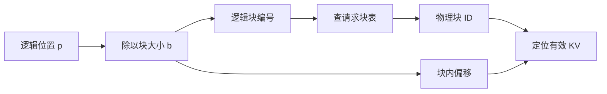
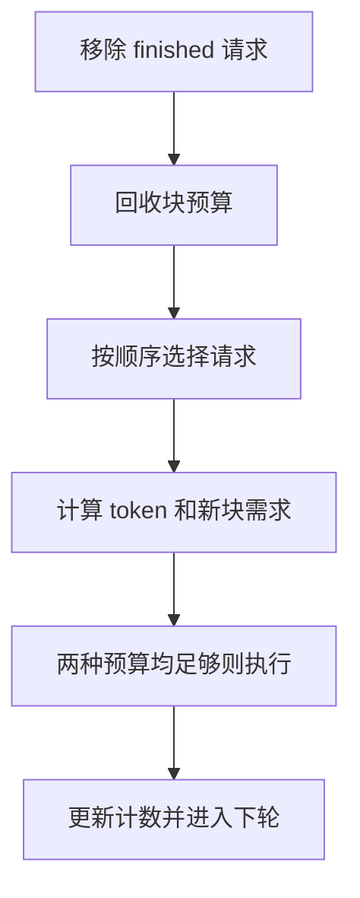
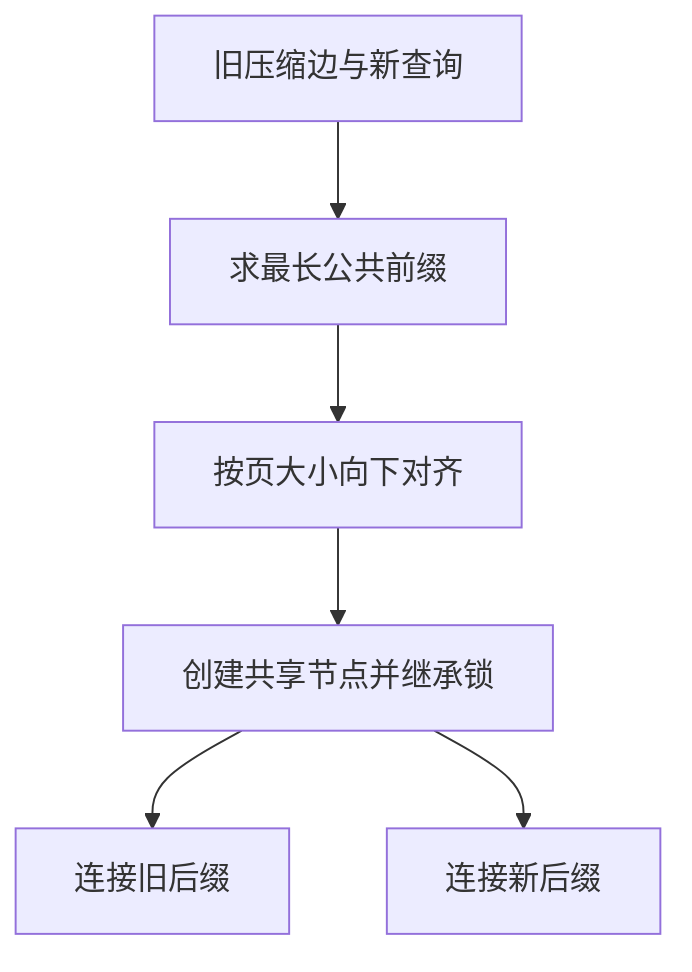

# 缓存分页与连续批处理

缓存管理决定有限显存怎样承载动态请求；调度决定每个迭代给谁计算。分页、共享、连续批处理和前缀树各有状态与约束。本页用块表、双预算与基数树分叉，把这些机制连接到具体源码。

## 学习目标

- 区分分页、共享和调度
- 计算尾块浪费
- 设计公平性与抢占实验

## 前置知识

需掌握[KV缓存原理与显存估算](KV缓存原理与显存估算.md)、整数除法、引用计数和队列。把token预算、块预算、请求数量分别记录。

## 基本机制

PagedAttention使逻辑连续的KV能够落在不连续物理块上；连续批处理在迭代边界换入换出请求；前缀缓存跨请求保存可兼容的计算状态。[PagedAttention §4](https://arxiv.org/html/2309.06180v1)与[SGLang §3](https://arxiv.org/html/2312.07104v2)分别展示页式管理和树式共享。

它们可以组合，但减少碎片并不直接决定调度公平性；命中率也不能解释所有服务延迟。必须追踪请求所持块、空闲队列、缓存索引与等待/运行/结束状态，才能看出资源究竟卡在哪里。

## 推导或示例

完整教学文件：[cache-scheduling.py](../../examples/inference/cache-scheduling.py)。每个函数对应下列一个知识点，只使用标准库与小型合成输入；教学计算不代表模型或服务实验。

### 知识点一：块表将逻辑连续性与物理连续性解耦

传统连续分配常把“未来可能增长到的最大长度”一起预留。分页只要求逻辑序列连续，物理块来自公共池。块大小 $b$，逻辑token位置 $p$（从0开始），请求块表 $T$ 保存物理ID：

$$\ell=\lfloor p/b\rfloor,\quad o=p\bmod b,\quad \text{physical}=T[\ell].$$

若块表为 `[7,1,3]`、$b=4$，位置9应访问逻辑块2、物理块3、偏移1。物理块7与1不相邻不影响因果顺序；内核按请求的块表访问，而不是对物理ID排序。$T$ 是元数据，不复制KV本体。

```python
def page_address(block_table, position, block_size):
    """把逻辑token位置映射到物理块和块内偏移；调用者保证位置已经有效。"""
    if type(position) is not int or position < 0 or type(block_size) is not int or block_size < 1:
        raise ValueError("位置须非负，块大小须为正整数")
    logical, offset = divmod(position, block_size)
    if logical >= len(block_table):
        raise IndexError("逻辑位置超出块表")
    physical = block_table[logical]
    if type(physical) is not int or physical < 0:
        raise ValueError("物理块ID须为非负整数")
    return {"logical_block": logical, "physical_block": physical, "offset": offset}
```

函数只做一次除法与索引，$O(1)$ 时间空间。块表长度限制分配容量，不知道最后块已经填了几个token；调用方还须检查有效长度。位置10虽在分配范围内，也可能尚未写入，不应被注意力读取。生产寻址还需要层、K/V、头维度及元素步幅，教学函数不计算真实指针。



共享前缀时两个请求可指向同一物理块，物理占用按唯一ID计。该版本 `KVCacheBlock`保存引用计数与空闲双向链表指针；`touch`让命中块引用加一，原先引用为0时将其从可淘汰队列移出；`free_blocks`引用减到0后入队。引用为0不等于内容立即被删除，真正复用槽位时才移除旧哈希。该版未缓存块优先放队头，缓存块放队尾，因此不能把所有释放都概括为同一FIFO策略。论文中的写时复制说明共享块被修改时需隔离；当前源码 `is_block_writable`还要求无已发布哈希，保护缓存键与内容一致。

[vLLM BlockPool.touch/free_blocks](https://github.com/vllm-project/vllm/blob/7a64fb8fc9239cb65e0df9313fa759594dfb206a/vllm/v1/core/block_pool.py#L752)；[FreeKVCacheBlockQueue](https://github.com/vllm-project/vllm/blob/7a64fb8fc9239cb65e0df9313fa759594dfb206a/vllm/v1/core/kv_cache_utils.py#L258)；[vLLM 缓存数据结构](https://github.com/vllm-project/vllm/blob/7a64fb8fc9239cb65e0df9313fa759594dfb206a/docs/design/prefix_caching.md#L102)；[PagedAttention §4.2–4.4](https://arxiv.org/html/2309.06180v1).

### 知识点二：连续批处理同时守住token和块预算

连续批处理不必等待一整批最慢的请求结束。每轮先移走已完成请求，回收其可释放资源，再推进已有请求或加入新请求。设请求已有 $a_i$ 块、已计算 $C_i$ 个位置、本轮计划 $\Delta_i$ 个token，则额外块需求为：

$$n_i=\max(0,\lceil(C_i+\Delta_i)/b\rceil-a_i),\quad n_i\le F,\quad\sum_i\Delta_i\le B.$$

$F$ 的单位是块，$B$ 的单位是token，不能直接比较两者。教学状态中开始有1个空闲块；一个finished请求再释放1块。Decode从4走到5需要新增1块；新提示从0走到4也需要1块。取 $b=4,B=5$，两者同轮得到1与4个token，结束后空闲块和token预算均为0。下一轮采样生成的新目标必须由调用者加入。

```python
def continuous_step(requests, free_blocks, token_budget, block_size):
    """先释放结束请求，再按顺序分配token与独立KV块；不足时跳过，不自动抢占。"""
    if any(type(x) is not int for x in (free_blocks, token_budget, block_size)) or min(free_blocks, token_budget) < 0 or block_size < 1:
        raise ValueError("资源预算须非负，块大小须为正整数")
    rows = [dict(r) for r in requests]
    if len({r["id"] for r in rows}) != len(rows):
        raise ValueError("请求ID必须唯一")
    for r in rows:
        if any(type(r[k]) is not int or r[k] < 0 for k in ("computed", "target", "blocks")):
            raise ValueError("请求计数须为非负整数")
        if r["computed"] > r["target"] or r["computed"] > r["blocks"] * block_size:
            raise ValueError("已计算位置必须有物理容量且不超目标")
    live = []
    for r in rows:
        if r.get("finished", False):
            free_blocks += r["blocks"]
        else:
            live.append(r)
    for r in live:
        take = min(r["target"] - r["computed"], token_budget)
        needed = max(0, (r["computed"] + take + block_size - 1) // block_size - r["blocks"])
        r["scheduled"] = 0
        if needed <= free_blocks:
            r["computed"] += take
            r["blocks"] += needed
            r["scheduled"] = take
            free_blocks -= needed
            token_budget -= take
    return {"requests": live, "free_blocks": free_blocks, "token_budget": token_budget}
```

`finished`独立于 `computed==target`：后者也可能只是这一轮追上目标，仍须采样或等待下一个token。函数复制输入，先释放全部结束请求，再按列表顺序尝试分配。资源不足跳过，不把token预算提前扣掉；每轮复杂度 $O(r)$，输出状态占 $O(r)$。调用前后“活跃已分配块+空闲块”保持不变，不能把结束请求释放的容量同时仍算入活跃占用。



真实vLLM还有抢占：该版 `allocate_slots`返回空表示不足，`schedule`选择牺牲者，`_preempt_request`释放块并将 `num_computed_tokens`重置到0，已输出token仍可作为恢复时的重算输入。论文讨论swap与重算，当前V1文档强调RECOMPUTE，不应据论文推断当前默认swap。我们的函数不模拟这部分，练习应额外记重算token数，否则吞吐可能看起来正常，某些请求却反复重算而长尾失控。该版源码还允许因预算无法推进的请求被跳过，故“FCFS绝无例外”也不是准确描述。

[vLLM 分配失败与抢占](https://github.com/vllm-project/vllm/blob/7a64fb8fc9239cb65e0df9313fa759594dfb206a/vllm/v1/core/sched/scheduler.py#L889)；[vLLM _preempt_request](https://github.com/vllm-project/vllm/blob/7a64fb8fc9239cb65e0df9313fa759594dfb206a/vllm/v1/core/sched/scheduler.py#L1744)；[V1 Preemption](https://github.com/vllm-project/vllm/blob/7a64fb8fc9239cb65e0df9313fa759594dfb206a/docs/configuration/optimization.md#L27)；[PagedAttention §4.5](https://arxiv.org/html/2309.06180v1).

### 知识点三：基数树分叉与锁定叶子的淘汰条件

哈希块表擅长按块查找，RadixAttention用压缩前缀树表达共享路径。一条边存多个token而非一个token，节点保存KV位置、父子关系、访问时间和锁引用。已有边 `[1,2,3,4]`，新查询 `[1,2,9]`，最长公共前缀是 `[1,2]`；将边拆成公共段与旧后缀 `[3,4]`，再挂新后缀 `[9]`。

若底层页大小为 $b$，匹配长度先对齐为 $m=b\lfloor\operatorname{LCP}(X,Q)/b\rfloor$。页大小4时这组长度为2的前缀不能复用完整页；页大小1时可复用2个token。这种“匹配长”和“可复用长”的区别与碎片、内核布局直接相关。

将上述计算或状态约束集中写为：

$$
m=b\left\lfloor\frac{\operatorname{LCP}(X,Q)}b\right\rfloor,\qquad 0\le\operatorname{LCP}(X,Q)-m<b.
$$

```python
def radix_split(edge_tokens, query_tokens, page_size=1, lock_ref=0):
    """返回压缩边的对齐公共前缀与两条后缀；共享前缀继承原路径锁数。"""
    if type(page_size) is not int or page_size < 1 or type(lock_ref) is not int or lock_ref < 0:
        raise ValueError("页大小须为正整数，锁数须非负")
    edge, query = list(edge_tokens), list(query_tokens)
    if any(type(t) is not int or t < 0 for t in edge + query):
        raise ValueError("token须为非负整数")
    n = 0
    for a, b in zip(edge, query):
        if a != b:
            break
        n += 1
    shared = n // page_size * page_size
    return {"matched_tokens": shared, "prefix": edge[:shared],
            "old_suffix": edge[shared:], "new_suffix": query[shared:],
            "prefix_lock_ref": lock_ref}
```

函数返回分叉后的三段和继承的锁数，不实际创建全树或分配GPU缓存。逐token找公共前缀是 $O(\min(|X|,|Q|))$，返回切片成本为 $O(|X|+|Q|)$；生产版 `match_at`使用倍增窗口和二分定位差异，不能把教学Python循环的性能当作该版本性能。`_split_node`同时切key、value与hash链，并复制旧节点lock_ref给新共享节点，以免正在使用的公共路径被误判为可淘汰。



锁定当前请求路径时沿祖先增加锁，释放时沿祖先减少。该版本 `evict`先把可淘汰叶子建堆，再逐个释放；叶被删除后，父节点只有“无子节点且锁为0”才重新入堆。若初始可淘汰叶子为 $v$，弹出 $e$ 个节点，建堆与淘汰的常见界为 $O(v+e\log(v+e))$，另加实际释放数据成本。不能先删共享祖先而保留后缀，那会破坏可复用的完整路径。论文的最长前缀优先在离线特定条件下有命中率结论，同时明确在线贪心可能饥饿；命中率高不是公平性证明。

[SGLang _match_prefix_helper 与 _split_node](https://github.com/sgl-project/sglang/blob/3ea7e210d28e26a13590d3244cedfe17f8c3e58c/python/sglang/srt/mem_cache/radix_cache.py#L651)；[SGLang evict 与路径锁](https://github.com/sgl-project/sglang/blob/3ea7e210d28e26a13590d3244cedfe17f8c3e58c/python/sglang/srt/mem_cache/radix_cache.py#L552)；[SGLang §3](https://arxiv.org/html/2312.07104v2)；[vLLM 哈希方案对照](https://github.com/vllm-project/vllm/blob/7a64fb8fc9239cb65e0df9313fa759594dfb206a/docs/design/prefix_caching.md#L5).

## 适用条件与限制

教学调度器只展示一个迭代且不承诺全局最优。共享块不能按每请求块数直接释放；异步GPU操作未结束时还可能需要延迟释放。生产代码中的前缀命中、混合层与推测解码各有额外约束。

块越小通常减少尾部浪费，但会增加块表项、寻址和管理工作；块越大则可能减少元数据但增加内碎片。需要实测总路径，不能只优化一个百分比。

## 实践任务

用三个不同长度请求推演五轮，记录到达、目标数、已计算数、物理块和空闲块。安排一个请求完成后同轮接纳新请求；再人为加入共享前缀，按唯一物理ID重算占用。最后画一个树叶淘汰序列，说明锁定祖先为什么不能删除，并单独列出抢占后的重算成本。

本页完整实践保持 `designed`。示例测试由统一 UT 流程记录，本页不宣称已测试或论文复现。

## 掌握标准

能由逻辑位置9找到物理块3偏移1；能证明单轮token预算和总块数守恒；能解释为什么ref_cnt=0仍可能保留可命中缓存。进阶答案需区分“已追上目标”与“请求结束”，并指出最长前缀优先可能饿死低命中长等待请求。


## 源码导读与边界推演

用块池状态检查一次释放与命中交错。物理块P先由A和B共用，引用数为2；A结束后为1，不能进入空闲队列。B结束后为0，P进入可淘汰集合，原前缀哈希仍可能存在。此时若C先命中P，touch必须先把P从空闲队列取出再增加引用；如果直接增加引用却留下空闲队列项，后续分配器可能同时把P交给无关请求，产生两个活跃请求写同一槽位的错误。真实实现用双向链表使“已知块从队列中间移除”保持常数时间，而不是线性查找。

分叉树也有同样的所有权问题。旧请求持有压缩边ABCD且锁数1，新请求在AB处分叉时，共享AB节点应继承旧路径的锁1；新请求真正开始使用AB后再增加到2。释放旧请求只应降到1，新请求结束才降到0。若分裂时把共享节点初始化为0，淘汰器会误以为它不被任何请求使用；若忘记释放路径上的祖先，则缓存会永久受保护，表现为“有缓存却无法腾出空间”。

连续批处理的准入还要看输出增长。一个新请求提示恰好占满一块，不意味着它整个生命周期只用一块；下一个位置就可能需要新块。若每轮都把剩余显存用来接收新提示，不为活跃Decode增长留下余量，下一轮可能不断抢占。源码中的watermark、lookahead与完整序列是否必须放得下，都是为了表达不同准入取舍；它们增加保守预留也可能降低短期并发，因此不能只用当轮空闲率评估策略。

公平性至少需要两个时间轴：首次获得计算的等待时间，以及开始后被暂停的累计时间。长前缀优先可提高命中，但一个从未命中的请求可能连续被插队；每轮分配token数相同，也可能因某请求重算旧KV而使真正生成进度不同。实践表应同时列“被执行token”“新增有效位置”“实际输出token”，这样才能辨认吞吐中包含了多少恢复工作。任何离线命中率最优结论，都不能直接替代在线尾延迟与饥饿检查。

[touch与free_blocks](https://github.com/vllm-project/vllm/blob/7a64fb8fc9239cb65e0df9313fa759594dfb206a/vllm/v1/core/block_pool.py#L752)；[分裂及路径锁](https://github.com/sgl-project/sglang/blob/3ea7e210d28e26a13590d3244cedfe17f8c3e58c/python/sglang/srt/mem_cache/radix_cache.py#L582)；[准入与watermark](https://github.com/vllm-project/vllm/blob/7a64fb8fc9239cb65e0df9313fa759594dfb206a/vllm/v1/core/kv_cache_manager.py#L516)；[缓存感知调度与饥饿限制 §3](https://arxiv.org/html/2312.07104v2).

---

[返回模块](../modules/推理.md) · [知识点索引](../../docs/知识点索引.md) · [完整教学代码](../../examples/inference/cache-scheduling.py) · [提出更正](https://github.com/yanbozhang/llm-systems-wiki/issues/new?template=knowledge.yml)

觉得这篇推导有帮助，可以在 [GitHub](https://github.com/yanbozhang/llm-systems-wiki) 点 Star 收藏更新；分享时欢迎链接到具体知识点，便于读者复核公式、代码与来源。
