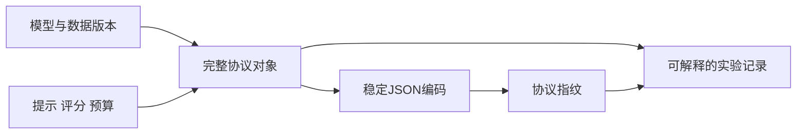
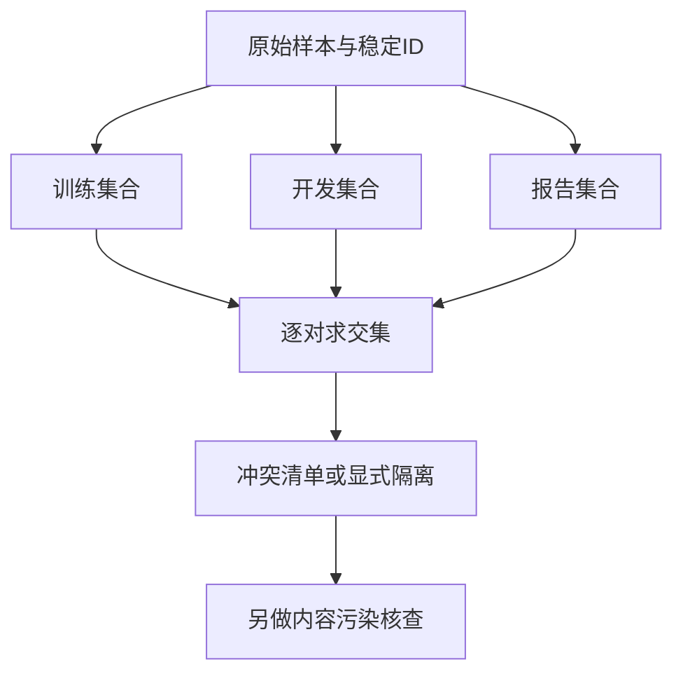
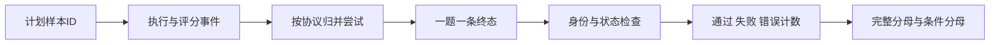

# 评测协议与可复现性

同一个模型在同一份题目上得到两个分数，差异可能来自提示模板、数据修订、评分器、失败处理或采样预算。评测协议的任务是让这些变化可见，让分数成为一个可以解释的测量结果。本页把协议身份、数据切分和逐题记录拆成三个知识点，沿着 LM Evaluation Harness 的任务对象与结果追踪源码理解边界。

## 学习目标

- 能把模型、数据、提示、评分与预算写成明确的协议对象，并解释指纹能证明什么。
- 能识别开发集和报告集之间的显式重叠，区分ID检查与污染检测。
- 能用包含运行错误的逐题记录计算不同分母的指标，拒绝把重试或失败悄悄隐藏。

## 前置知识

先掌握集合交集、条件概率、JSON序列化和版本控制。将“数据文件相同”“模型参数相同”“运行过程确定”分开理解；哈希比较的是被编码的内容，无法自动观察没有被记录的硬件、外部服务和随机数状态。

## 基本机制

一次评测可以拆成协议、样本构造、请求执行、结果解释和聚合五层。Task 决定从哪份数据构造哪些请求，模型适配器完成推理，评分器把输出转换为逐样本值，追踪器保存配置与聚合结果。任何一层改变都可能改变测量对象。学习时应先画清这些责任边界，再讨论最终分数是否可比。

## 推导或示例

### 知识点一：协议身份与可复现性不是同一件事

协议身份回答“这两次运行声明使用的条件是否相同”。可以把数据版本、模型权重版本、分词器和聊天模板、提示模板、评分器版本、采样参数与预算写入一个对象。协议对象宜保存可持久定位的值：提交SHA比随时移动的main分支更明确，数据校验和比下载日期更明确。改变评测规则时产生新身份，而不是直接覆盖旧实验记录。

这个设计仍有边界。协议相同只说明被记录的输入相同；不同GPU内核的舍入、服务端模型的静默升级、并发调度及未冻结的外部网页，都可能导致输出不同。因此“可比较”“能重新运行”“逐比特复现”应当分别报告。本库下面的指纹函数是教学协议，不声称与某个评测工具的整套缓存键完全等价。

#### 公式与推导

$$
P=(M,D,T,G,S,B),\qquad h(P)=\operatorname{SHA256}(\operatorname{UTF8}(\operatorname{CanonicalJSON}(P)))
$$

M、D分别代表模型与数据身份，T是输入构造，G是生成设置，S是评分规则，B是资源或尝试预算。CanonicalJSON在本例中特指键排序、固定分隔符、UTF-8编码且拒绝NaN；它不是跨所有语言实现的通用规范。将字典的书写顺序调换，序列化结果保持相同；将seed从7改为8，编码内容改变，指纹也应改变。SHA-256碰撞在一般工程核对中可忽略，但哈希不是访问控制机制，也不能证明数据来源真实。

#### 代码与逐步说明

```python
def protocol_fingerprint(protocol):
    """非空JSON对象生成稳定SHA-256；键顺序不影响身份，字段值影响身份。"""
    if not isinstance(protocol, dict) or not protocol:
        raise ValueError('协议必须是非空对象')
    payload = json.dumps(protocol, sort_keys=True, separators=(',', ':'),
                         ensure_ascii=False, allow_nan=False).encode('utf-8')
    return hashlib.sha256(payload).hexdigest()
```

先拒绝空协议，避免用一个没有信息的对象假装冻结条件。随后将协议编码成稳定字节，再计算摘要。代码保留全部字段，因此增加一个评分器版本也会影响身份；不要先手工挑出几个“似乎重要”的字段再丢弃其余条件。函数返回的是标识符，真实协议对象仍应与结果一起保存，以便别人解释两个摘要为什么不同。

#### 核心实现结构



图中指纹与协议正文同时进入记录。若只保存摘要，审阅者只能发现“不一样”，无法还原改了什么；若只保存可变链接，则同一份记录在未来可能指向不同内容。

#### 源码导读与边界

该版本源码中，GeneralConfigTracker.log_experiment_args 保存模型信息，并分别计算 system_instruction_sha 与 chat_template_sha；EvaluationTracker.save_results_aggregated 将逐样本的doc_hash、prompt_hash、target_hash合成任务指纹并保存配置。阅读顺序是先看输入追踪，再看聚合保存。源码确实记录这些字段，但本页额外提出的完整协议对象属于教学设计。

依据：[LM Evaluation Harness 结果追踪](https://github.com/EleutherAI/lm-evaluation-harness/blob/d6de81643928d653435c431bae19945d41d32520/lm_eval/loggers/evaluation_tracker.py#L95)；[LM Evaluation Harness 任务协议](https://github.com/EleutherAI/lm-evaluation-harness/blob/d6de81643928d653435c431bae19945d41d32520/lm_eval/api/task.py#L268)。

常见错误是把同一个模型名称当成同一组权重，或把固定seed当成确定性的充分条件。一个有效反例是：模型、数据和seed都不变，只替换聊天模板，模型实际接收的token序列就可能变化。

### 知识点二：开发反馈和最终报告必须分开

开发阶段要查看错误、改提示、选择模型和调整参数，这些决策本身会吸收数据集的信息。即使没有做梯度训练，用报告集反复挑选最佳设置也会产生选择偏差。因此首先区分训练、开发、报告三个角色，再决定few-shot示例从哪里抽取。文件名叫test并不自动代表它从未被用于调参。

最小检查是比较样本身份集合。它可以阻止同一ID同时出现在两个切分中，但对重新命名、改写、翻译和预训练中已经出现的内容无能为力。不要将这个廉价的结构检查称为“已完成去污染”；后续应连接内容指纹、近重复检查及来源时间线。

#### 公式与推导

$$
I_{ab}=D_a\cap D_b,\qquad \text{显式隔离成立}\iff \forall a\ne b,\ I_{ab}=\varnothing
$$

D_a是切分a的唯一ID集合。本例把同一切分内的重复ID折叠成集合，目的仅是检查跨切分交集；切分内部的重复比例需要另一项统计。假设train={a,b}，dev={c}，test={b,d}，则唯一非空交集是train与test之间的{b}。如果test中的b被重命名为x但正文相同，这个检查会通过，说明身份检查不能替代内容检测。

#### 代码与逐步说明

```python
def split_overlap(splits):
    """输入切分名到字符串ID列表的映射，返回有交集的切分对及排序后的ID。"""
    if not isinstance(splits, dict):
        raise ValueError('切分必须是对象')
    sets = {}
    for name, ids in splits.items():
        if not isinstance(name, str) or not isinstance(ids, list):
            raise ValueError('切分名须为字符串，ID须为列表')
        if any(not isinstance(x, str) or not x for x in ids):
            raise ValueError('ID须为非空字符串')
        sets[name] = set(ids)
    return {(a, b): sorted(sets[a] & sets[b])
            for a, b in combinations(sorted(sets), 2) if sets[a] & sets[b]}
```

代码先验证ID格式，避免把整数1与字符串“1”混在一个来源系统里产生不清晰的比较。然后按切分名称排序，逐对求交集，使结果顺序稳定。返回值只包含非空交集，调用方可据此显示冲突或阻断报告；空映射表示未发现显式重叠，不是对数据独立性的证明。

#### 核心实现结构



三类样本进入交集检查，而内容污染检查保留为后续独立步骤。这样可以看出：切分规则不是一个目录组织习惯，而是决定哪些信息允许进入开发反馈的协议。

#### 源码导读与边界

Task 分别定义 training_docs、validation_docs 和 test_docs；ConfigurableTask 根据配置读取相应split。还应特别阅读fewshot_docs：当没有训练或验证材料时，基类存在回退到test_docs并发出警告的路径。框架提供了数据访问机制，但不会替维护者自动证明切分独立，配置责任不能被一条“工具已支持few-shot”代替。

依据：[LM Evaluation Harness 任务协议](https://github.com/EleutherAI/lm-evaluation-harness/blob/d6de81643928d653435c431bae19945d41d32520/lm_eval/api/task.py#L169)；[LM Evaluation Harness 去污染说明](https://github.com/EleutherAI/lm-evaluation-harness/blob/d6de81643928d653435c431bae19945d41d32520/docs/decontamination.md)。

把报告集改名为验证集并继续公布该集最优成绩，不会消除选择偏差。有效的修正是冻结开发决策后使用此前未参与选择的报告集，并说明数据与版本边界。

### 知识点三：失败、重试和分母决定结果含义

一条执行记录至少要能回答：是哪一道题、用了哪份协议、执行到什么终态、评分依据在哪里。本页把终态简化为passed、failed、error：前两者代表完成评分，error代表执行或评估链路未能形成有效判定。error不能被默默删除；否则服务最不稳定的样本恰好被移出分母，系统看起来反而更准确。

同一道题的多次尝试也不能直接混在一张“每题一行”的表里。这里选择最容易审阅的契约：score_run只接受已按协议整理好的一题一条终态，遇到重复ID报错。若要采用固定重试预算，需在进入本函数前按独立规则汇总，并保留所有尝试记录，不能随意取最好的一次结果。

#### 公式与推导

$$
N=N_{\mathrm{pass}}+N_{\mathrm{fail}}+N_{\mathrm{error}},\quad S_{\mathrm{e2e}}=\frac{N_{\mathrm{pass}}}{N},\quad A_{\mathrm{scored}}=\frac{N_{\mathrm{pass}}}{N-N_{\mathrm{error}}}
$$

三个计数互斥且覆盖所有计划样本，所以端到端成功率分母是N。已评分准确率是在“成功获得评分”的条件下计算，条件分母不同。当三题分别通过、失败、报错时，端到端成功率为1/3，已评分准确率为1/2，错误率为1/3；这些数字同时成立但不能互换。如果所有题都error，后一个比率未定义，本例返回None，而不是伪造0%或100%。

#### 代码与逐步说明

```python
def score_run(records):
    """一题一条终态记录；passed/failed/error全部进入端到端成功率分母。"""
    if not isinstance(records, list) or not records:
        raise ValueError('至少需要一条记录')
    seen, counts = set(), dict.fromkeys(('passed', 'failed', 'error'), 0)
    for row in records:
        if not isinstance(row, dict):
            raise ValueError('记录必须是对象')
        key, status = row.get('id'), row.get('status')
        if not isinstance(key, str) or not key or key in seen:
            raise ValueError('样本ID缺失或重复')
        if not isinstance(status, str) or status not in counts:
            raise ValueError('非法终态')
        seen.add(key)
        counts[status] += 1
    n = len(records)
    scored = n - counts['error']
    return {'n': n, 'counts': counts, 'success_rate': counts['passed'] / n,
            'error_rate': counts['error'] / n,
            'scored_accuracy': counts['passed'] / scored if scored else None}
```

records必须非空；每条记录验证身份和终态后才进入计数。seen集合阻止重复样本悄悄改变权重。返回结果同时保留原始计数和两个不同口径的比率，使下游图表可以直接显示分母。函数没有执行模型、重试或恢复；它只演示最终记录的聚合契约。

#### 核心实现结构



尝试归并在评分汇总之前，并且需要单独定义。图中没有从error直接绕过计数的路径，正是为了保留工程故障对系统效果的影响；运行成功与任务正确分属不同层。

#### 源码导读与边界

EvaluationTracker 把聚合结果与逐样本结果分成两个保存入口；save_results_aggregated可以附带任务哈希，save_results_samples保存可追查样本。Task.process_results负责把模型结果转成指标。阅读这三者能区分“保存什么”“怎样评分”和“怎样聚合”。本页三状态账本是教学抽象，不能说成源码原样采用这三个枚举。

依据：[LM Evaluation Harness 结果追踪](https://github.com/EleutherAI/lm-evaluation-harness/blob/d6de81643928d653435c431bae19945d41d32520/lm_eval/loggers/evaluation_tracker.py#L230)；[LM Evaluation Harness 结果追踪](https://github.com/EleutherAI/lm-evaluation-harness/blob/d6de81643928d653435c431bae19945d41d32520/lm_eval/loggers/evaluation_tracker.py#L320)；[LM Evaluation Harness 任务协议](https://github.com/EleutherAI/lm-evaluation-harness/blob/d6de81643928d653435c431bae19945d41d32520/lm_eval/api/task.py#L403)。

当两个系统错误率相差很大时，只比较已评分准确率容易误导。应同时给出完整样本量、错误率和条件指标；如果运行期间修改了预算或跳过规则，应视为协议发生变化。

## 适用条件与限制

这些示例只验证协议表示、显式ID重叠和聚合口径，不执行真实模型或提供隔离执行环境。固定协议仍可能受到数值非确定性、外部依赖变化和数据分布偏移影响。源码定位只对应页面链接中的提交；工具后续更改默认行为时，应重新核对相应函数和结果字段。

## 实践任务

构造两个只在键顺序上不同的协议，核对指纹相同；再逐项改变提示、评分器或预算并记录身份变化。为train/dev/test各建三个ID，制造一个跨切分重叠与一个仅正文重复的反例。最后为四题分别记录两次通过、一次失败、一次错误，手算完整成功率和已评分准确率，并解释为何不能只发布较高的那个数字。

完整教学示例：[源码文件](../../examples/benchmark/benchmark-protocol.py)。它使用 Python 3.11+ 标准库，不调用真实模型；页内代码是对应函数片段。单元测试证明本例的数学或状态性质，完整基准实验仍为“已设计”。

## 掌握标准

能解释指纹、可比较性和确定性之间的区别；能从fewshot_docs源码指出何时可能回退读取test数据；能准确计算不同分母，并说明重复ID为何必须先按协议归并。提交物应包含协议对象、冲突样本、逐题终态表及对一个失败例子的解释。

## 源码阅读路径与继续学习

先沿 GeneralConfigTracker → EvaluationTracker → Task 的顺序阅读，再进入[数据污染与评测集治理](数据污染与评测集治理.md)、[评测指标与统计推断](评测指标与统计推断.md)和[Agent任务基准与执行评估](Agent任务基准与执行评估.md)。使用[评测协议模板](../../templates/评测协议模板.md)记录自己的实验设计；只保存本页演示输出不能证明已完成真实模型评测。

返回[Benchmark模块](../modules/Benchmark.md)，或查看[能力地图](../../docs/能力地图.md)。

---

[返回模块](../modules/Benchmark.md) · [知识点索引](../../docs/知识点索引.md) · [完整教学代码](../../examples/benchmark/benchmark-protocol.py) · [提出更正](https://github.com/yanbozhang/llm-systems-wiki/issues/new?template=knowledge.yml)

觉得这篇推导有帮助，可以在 [GitHub](https://github.com/yanbozhang/llm-systems-wiki) 点 Star 收藏更新；分享时欢迎链接到具体知识点，便于读者复核公式、代码与来源。
