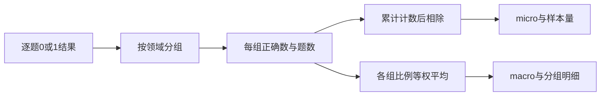
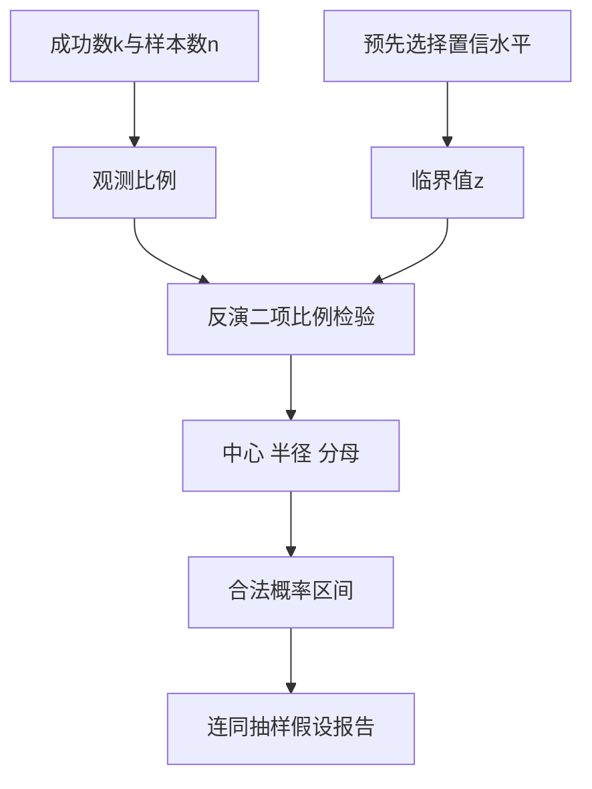
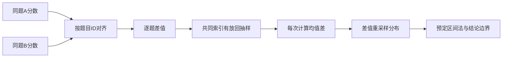

# 评测指标与统计推断

准确率从82%变成84%，并不能独自回答系统是否更好：题目类别的权重可能改变，有限样本会波动，同一道题上的两个系统也不是两组独立观测。本页沿着聚合口径、单模型区间、配对比较三个层次，用可核算例子连接评测框架与统计实现。

## 学习目标

- 能根据目标分布选择micro或macro，并从逐题记录还原分母。
- 能推导并计算Wilson比例区间，解释适用假设与边界情形。
- 能按相同题目的配对关系重采样，区分均值差分布、置信区间与胜负结论。

## 前置知识

先学习[评测协议与可复现性](评测协议与可复现性.md)。需要理解样本均值、方差、条件概率和二次不等式；将“这批题的观测差异”和“目标任务分布中的期望差异”分开。实验中题目是否独立、类别权重怎样确定，必须先于公式计算说明。

## 基本机制

统计计算先决定观测单位，再决定指标和权重，最后估计不确定性。同一个逐题结果表可以有多种合法聚合方式，但每种方式回答不同问题。HELM强调多场景、多指标的评价，LM Evaluation Harness将任务级指标与子任务聚合分离；使用这些工具时仍需清楚解释自己选择的口径。

## 推导或示例

### 知识点一：micro与macro改变了谁拥有更大权重

设一个通用能力测试包含不同领域。有的领域有90题，有的只有10题。逐题等权意味着前者对总分的影响是后者的九倍；类别等权则认为每个领域在最终目标中同样重要。两者都可能合理，关键在于评测目标是否希望代表实际请求频率，还是希望防止小领域被平均值淹没。

聚合前应保存每组的题数和正确数。只拿到已经四舍五入的组平均值，再尝试还原总体准确率，可能引入额外误差；而将不同量纲的指标直接平均，更不等同于macro准确率。下面的实现只接受二元正确性结果，明确限定自己的统计对象。

#### 公式与推导

$$
A_{\mathrm{micro}}=\frac{\sum_{g=1}^{G}c_g}{\sum_{g=1}^{G}n_g},\qquad A_{\mathrm{macro}}=\frac{1}{G}\sum_{g=1}^{G}\frac{c_g}{n_g}
$$

G为非空类别数，n_g为该类别样本数，c_g为答对数。若A类81/90正确，B类1/10正确，则micro=(81+1)/(90+10)=0.82，macro=(0.9+0.1)/2=0.5。差异来自权重，而不是有人算错。如果真实请求中A/B恰好占90%/10%，micro更贴近该请求混合；如果目标要求两个领域同等重要，macro更直接。类别为空时不能把它悄悄计成0分，因此本例拒绝空组。

#### 代码与逐步说明

```python
def grouped_accuracy(groups):
    """分组二元结果分别计算逐题micro和类别等权macro；每组必须非空。"""
    if not isinstance(groups, dict) or not groups:
        raise ValueError('至少一个分组')
    means, correct, total = {}, 0, 0
    for name, values in groups.items():
        if not isinstance(name, str) or not isinstance(values, list) or not values:
            raise ValueError('分组名须为字符串且结果列表非空')
        if any(type(v) not in (int, bool) or v not in (0, 1) for v in values):
            raise ValueError('每题结果只能为0或1')
        means[name] = sum(values) / len(values)
        correct += sum(values)
        total += len(values)
    return {'micro': correct / total, 'macro': math.fsum(means.values()) / len(means),
            'by_group': means, 'n': total}
```

逐组验证0/1输入，计算组均值，并同时累计正确数与总数。最后分别做按题数加权与按类别等权的平均，返回by_group和n以便结果可追溯。代码没有对缺失类别自动补零，也不接受任意真值对象；否则字符串“错误”会被Python视为真值，破坏指标语义。

#### 核心实现结构



两个聚合分支共享同一份原始计数；它们不是可以在报告末尾互相替换的显示格式。保存分组明细可以暴露“总分升高但小领域退化”的情况，并支持后续按目标分布重新加权。

#### 源码导读与边界

LM Evaluation Harness的aggregate_subtask_metrics接收metrics和sizes；weight_by_size为假时将所有权重置为1，然后执行加权平均。这段代码说明框架允许选择两种口径，也明确提醒非均值聚合不能照搬该规则。HELM的多场景组织提供了为什么需要保留分层结果的背景。

依据：[LM Evaluation Harness 指标实现](https://github.com/EleutherAI/lm-evaluation-harness/blob/d6de81643928d653435c431bae19945d41d32520/lm_eval/api/metrics.py#L686)；[HELM：语言模型的整体评估](https://arxiv.org/html/2211.09110)。

不要用macro掩盖真实高流量领域的失败，也不要用micro掩盖覆盖面问题。选择权重属于评测协议；看完结果后挑对自己有利的口径，会把统计选择混入模型比较。

### 知识点二：比例区间来自检验反演而非给分数加常数

观测准确率是有限题目上的比例，不是总体能力的精确常数。常见的对称近似在样本少或比例接近0、1时可能给出负下界或退化区间。Wilson方法通过反演二项比例的正态近似检验构造区间，在这些边界上通常更合理，但它仍依赖观测过程和抽样假设。

计算之前应明确成功事件，例如“该题通过全部固定测试”。如果同一文档生成许多相近题、同一次Agent会话中抽取多步结果，直接把每个结果当成独立Bernoulli试验可能低估不确定性。区间方法无法修复样本不独立或评价目标偏离的问题。

#### 公式与推导

$$
L,U=\frac{\hat p+\frac{z^2}{2n}\ \mp\ z\sqrt{\frac{\hat p(1-\hat p)}{n}+\frac{z^2}{4n^2}}}{1+\frac{z^2}{n}},\qquad \hat p=\frac{k}{n}
$$

k为成功次数，n为样本数，z为标准正态分布的双侧临界值。把((p̂-p)²)/(p(1-p)/n)≤z²整理为关于p的二次不等式，求两根得到上下界。95%区间常取z≈1.96。对90/100，结果约为[0.826,0.945]，而不是简单写90%±一个固定百分点。若k=0，下界为0但上界仍大于0；观察到零次成功不代表总体成功率严格等于零。

#### 代码与逐步说明

```python
def wilson_interval(successes, total, z=1.959963984540054):
    """二项比例的双侧Wilson区间；z默认约为标准正态分布的97.5%分位。"""
    if type(successes) is not int or type(total) is not int or total <= 0:
        raise ValueError('计数须为整数且总数为正')
    if not 0 <= successes <= total or not isinstance(z, (int, float)) or not math.isfinite(z) or z <= 0:
        raise ValueError('计数范围或z不合法')
    p = successes / total
    denominator = 1 + z * z / total
    center = p + z * z / (2 * total)
    radius = z * math.sqrt(p * (1 - p) / total + z * z / (4 * total * total))
    return max(0.0, (center - radius) / denominator), min(1.0, (center + radius) / denominator)
```

代码分成共同分母、中心项和半径项，方便逐项对应公式。计数必须是整数且满足0≤k≤n、n>0；z需要有限且为正。返回值限制在合法概率范围，以消除浮点舍入造成的极小越界。默认z是95%双侧区间的常用值，调用方如果改变z，报告中必须同步改变置信水平说明。

#### 核心实现结构



置信水平在观察比较结果之前选择，不能因为区间不够窄就事后降低标准。图的最后一步保留抽样假设，因为一个数值计算正确的区间仍可能对应错误的观测单位。

#### 源码导读与边界

NIST统计手册给出Wilson区间的反演思路与公式，并说明它与常见对称近似的区别。SciPy的BinomTestResult.proportion_ci把exact、wilson和wilsoncc作为不同方法；_binom_wilson_conf_int实现对应计算。本例没有连续性校正，也不等同于exact区间，应在报告中使用准确名称。

依据：[NIST 二项比例区间](https://www.itl.nist.gov/div898/handbook/prc/section2/prc241.htm)；[SciPy 二项检验与Wilson区间实现](https://github.com/scipy/scipy/blob/ebde5c3eb28bf9410878ea5f242ecf4b5f596b3d/scipy/stats/_binomtest.py)。

95%置信区间不是“该固定参数有95%概率位于这一次给出的区间内”的直接频率学解释。也不要仅凭两条区间是否重叠来代替同题目配对比较。

### 知识点三：比较同一批题时要保留配对关系

比较A、B两个系统时，同一道题通常同时对两者容易或困难，因此两列结果相关。把A列和B列独立重采样，会打散题目配对结构，估计的是另一个随机过程。更直接的做法是先形成逐题差值，再对题目索引有放回抽样；这样每次抽中的都是完整的一对结果。

Bootstrap把观察到的经验分布当作总体的近似，并反复重采样统计量。它不能创造未覆盖的任务类型，也不能消除数据污染。面对同文档多题、同用户多会话等聚类数据，应考虑按文档或用户抽样，而不是机械按行抽样；抽样单位必须与独立性假设一致。

#### 公式与推导

$$
\widehat\Delta=\frac{1}{n}\sum_{i=1}^{n}(a_i-b_i),\qquad \Delta^{*(r)}=\frac{1}{n}\sum_{j=1}^{n}(a_{I_j^{(r)}}-b_{I_j^{(r)}}),\quad I_j^{(r)}\sim\operatorname{Uniform}\{1,\ldots,n\}
$$

a_i、b_i是同一道题的分数，I为有放回抽取的题目索引。若A=[1,1,0,1]、B=[1,0,0,1]，逐题差值为[0,1,0,0]，观测均值差为0.25。某次抽到索引[1,1,0,2]时，重采样差值是[1,1,0,0]，均值为0.5；抽到[0,2,3,0]时为0。重复这些抽样形成的是差值分布，可进一步按预先选择的方法构造区间。

#### 代码与逐步说明

```python
def paired_bootstrap(a, b, draws=1000, seed=7):
    """相同题目的A/B分数按共同索引有放回重采样，返回均值差分布。"""
    if not isinstance(a, list) or not isinstance(b, list) or not a or len(a) != len(b):
        raise ValueError('两组非空结果必须逐题等长')
    if type(draws) is not int or draws <= 0 or type(seed) is not int:
        raise ValueError('抽样次数须为正整数，种子须为整数')
    if any(type(x) not in (int, float) or not math.isfinite(x) or not 0 <= x <= 1 for x in a + b):
        raise ValueError('分数须为0到1的有限数')
    differences = [x - y for x, y in zip(a, b)]
    rng, n = random.Random(seed), len(differences)
    samples = [math.fsum(differences[rng.randrange(n)] for _ in range(n)) / n
               for _ in range(draws)]
    return {'observed': math.fsum(differences) / n, 'replicates': samples}
```

函数先验证两列逐题等长、分数有限且位于0至1。使用局部Random实例，避免修改进程其他代码的随机状态。每次抽样统一选取差值数组的索引，天然保留配对。输出observed和所有replicates，刻意不在这个函数中选择区间算法，防止把简单百分位法、basic和BCa混为一谈；生产报告需进一步明确所用方法和重复次数。

#### 核心实现结构



对齐在重采样之前完成。仅有等长数组并不证明题目顺序一致，真实实验应先按稳定ID连接两份结果；代码中的等长检查是最后一道结构检查，不替代数据对齐。

#### 源码导读与边界

SciPy bootstrap文档明确paired参数：配对模式对各组数据使用同一组重采样索引，并区分percentile、basic和BCa。LM Evaluation Harness的_bootstrap_internal使用局部随机生成器和有放回抽样，bootstrap_stderr进一步估计统计量的标准误差。本例展示配对均值差分布，既不是该框架的完整并行实现，也不把标准误差直接叫作置信区间。

依据：[SciPy Bootstrap 官方文档](https://docs.scipy.org/doc/scipy/reference/generated/scipy.stats.bootstrap.html)；[LM Evaluation Harness 指标实现](https://github.com/EleutherAI/lm-evaluation-harness/blob/d6de81643928d653435c431bae19945d41d32520/lm_eval/api/metrics.py#L508)。

如果不断换模型、换提示后只报告最佳组合，普通区间不会自动补偿多重选择。样本量很小或差值分布高度离散时，增加bootstrap次数只能减少蒙特卡洛噪声，不能增加原始信息量。

## 适用条件与限制

本页统计值均为教学算例，没有对应任何真实模型成绩。Wilson区间和bootstrap都依赖观测定义；对于时间序列、聚类任务或自适应收集的数据，需要重新确定抽样方式。代码实现用于理解公式与接口语义，不替代专业统计分析，也不把0.02的差值自动解释为有实际价值的提升。

## 实践任务

先复算两类别的micro/macro反例，再比较0/10、5/10、10/10和90/100的Wilson区间。对一份同题A/B表按ID对齐，手工列出两次共同索引重采样；用相同seed验证分布可重复，用A=B和固定差值构造不变量检查。最后说明一次区间计算尚未解决的数据偏差与多次选型问题。

完整教学示例：[源码文件](../../examples/benchmark/benchmark-metrics.py)。它使用 Python 3.11+ 标准库，不调用真实模型；页内代码是对应函数片段。单元测试证明本例的数学或状态性质，完整基准实验仍为“已设计”。

## 掌握标准

能说明每个分母、权重、观测单位和临界值的含义；能从源码找出加权聚合的开关，并区分标准误差、分布与区间；能解释为什么同题比较应保留配对，为什么更多重采样不能补足缺失的领域。提交的统计表应同时包含原始计数、分组结果、方法及假设。

## 源码阅读路径与继续学习

依次阅读aggregate_subtask_metrics、SciPy的proportion_ci与bootstrap文档，再进入[通用能力基准与选型](通用能力基准与选型.md)、[模型裁判与人工校准](模型裁判与人工校准.md)和[推理与代码生成评测](推理与代码生成评测.md)。这些主题分别展示分层任务、裁判误差和采样预算如何改变统计问题。

返回[Benchmark模块](../modules/Benchmark.md)，或查看[能力地图](../../docs/能力地图.md)。

---

[返回模块](../modules/Benchmark.md) · [知识点索引](../../docs/知识点索引.md) · [完整教学代码](../../examples/benchmark/benchmark-metrics.py) · [提出更正](https://github.com/yanbozhang/llm-systems-wiki/issues/new?template=knowledge.yml)

觉得这篇推导有帮助，可以在 [GitHub](https://github.com/yanbozhang/llm-systems-wiki) 点 Star 收藏更新；分享时欢迎链接到具体知识点，便于读者复核公式、代码与来源。
