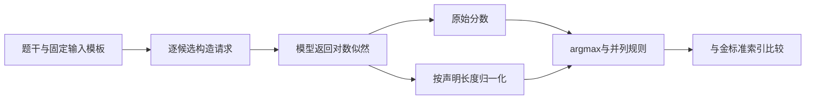
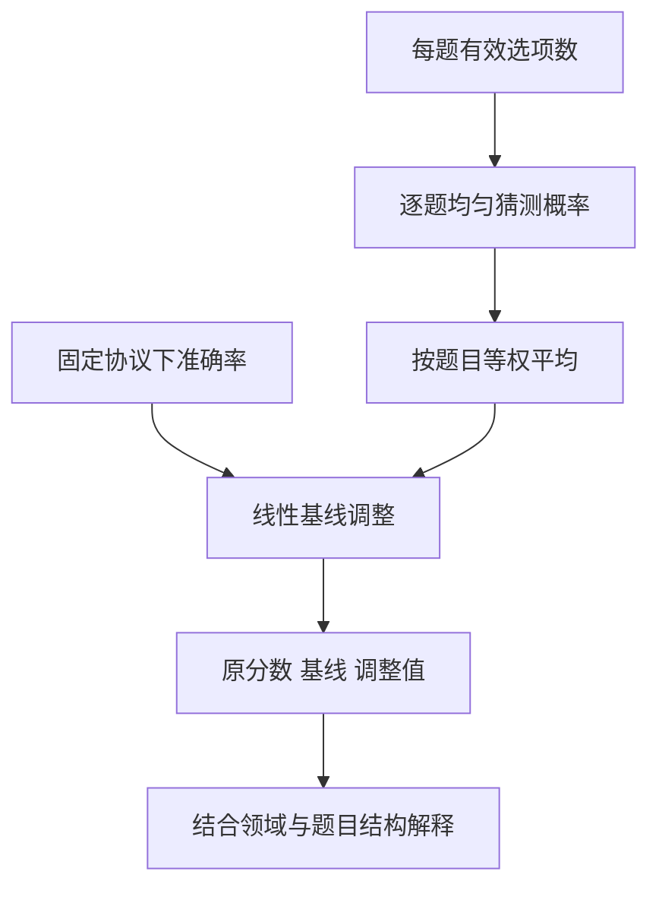
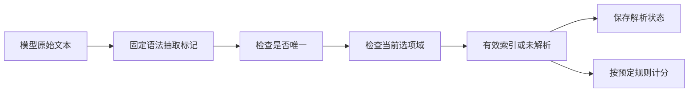

# 通用能力基准与选型

通用能力基准不是一个统一的“智力分数”。题型、领域、选项数量、输入模板和答案解析方式都会参与定义测量对象。本页用选择题作为具体入口，解释模型输出怎样变成分数，以及哪些看似很小的工程选择会改变模型排名。MMLU类知识覆盖、专业推理和动态新题应组成有目标的组合，而不是只挑一个榜单最大值。

## 学习目标

- 能从对数似然构造选择题预测，解释长度归一化可能改变排序。
- 能计算不同选项数量下的均匀随机基线，并说清基线调整的局限。
- 能将答案解析视为版本化评分协议，保留无法解析与相互矛盾的输出。

## 前置知识

先理解对数概率、argmax、加权平均和条件概率，阅读[评测指标与统计推断](评测指标与统计推断.md)。区分模型为候选文本计算似然与模型自由生成一个答案字母：两者的请求类型、解析器和失败模式不同。

## 基本机制

选择题评测常见两条路径：对各候选文本计算条件对数似然并选最高项，或让模型生成答案再解析为选项。题目难度与随机基线由任务决定，最后还要按领域聚合。明确请求、长度口径和解析策略后，分数才具备可解释的比较基础。

## 推导或示例

### 知识点一：候选似然与长度归一化可能给出不同答案

若模型接口支持条件对数似然，可以对每个候选答案在相同上下文下评分。候选越长，连乘概率往往越小，但这不意味着任何长度归一化都更合理：归一化改变了优化目标，还取决于长度是字符数、字节数还是token数。不同分词器下token长度也可能不同，因此长度口径属于评测协议。

输入细节同样重要。候选前是否加空格、聊天模板怎样包装、是否把选项字母与全文一起送入模型，都会改变实际token序列。源码导读应从construct_requests追到process_results，而不是只看最后的argmax。

#### 公式与推导

$$
\ell_j=\sum_{t=1}^{|c_j|_{\mathrm{token}}}\log p(c_{j,t}\mid x,c_{j,<t}),\qquad \hat j=\arg\max_j\ell_j,\qquad \hat j_{\mathrm{norm}}=\arg\max_j\frac{\ell_j}{L_j}
$$

x是相同题干上下文，c_j是候选文本，L_j是另行声明的正长度。若两个候选的对数分数为-2和-3，原始评分选择第一项；当归一化长度为1和4时，归一化分数为-2和-0.75，改为选择第二项。这是目标函数发生变化的结果，不能把两个成绩当成同一口径。式中求和长度是token数，但归一化L_j可以是另一个明确约定的长度。

#### 代码与逐步说明

```python
def choice_prediction(log_scores, lengths, normalize=False):
    """按对数分数或分数/长度选最大项；并列时选第一项，长度单位由协议给出。"""
    if not isinstance(log_scores, list) or not isinstance(lengths, list) or not log_scores or len(log_scores) != len(lengths):
        raise ValueError('分数与长度须非空且等长')
    if any(type(x) not in (int, float) or not math.isfinite(x) for x in log_scores):
        raise ValueError('分数须为有限数')
    if any(type(n) is not int or n <= 0 for n in lengths):
        raise ValueError('长度须为正整数')
    scores = [score / length if normalize else score for score, length in zip(log_scores, lengths)]
    return max(range(len(scores)), key=scores.__getitem__)
```

代码先验证分数有限、长度为正整数，避免除零或NaN破坏排序。normalize开关只控制是否除以给定长度；并列时选择最前项，使规则可重复。函数没有调用模型，也没有推断文本长度；调用方必须保存lengths从何而来。真正的评测还要固定候选顺序，并检查改换顺序是否引入偏置。

#### 核心实现结构



原始与归一化是两条不同评分路径。它们可同时报告，但指标名称和长度单位必须明确；把开关隐藏在脚本默认值里会破坏跨实验比较。

#### 源码导读与边界

所读MultipleChoiceTask.construct_requests为每个候选构造loglikelihood请求，并在候选前加入空格。process_results分别计算acc与acc_norm；该具体方法中的completion_len使用Python字符串len，不能直接称作token数。其他Task或适配器可能采用不同口径，应沿实际任务类核对。本例因此让lengths由调用方显式传入。

依据：[LM Evaluation Harness 任务协议](https://github.com/EleutherAI/lm-evaluation-harness/blob/d6de81643928d653435c431bae19945d41d32520/lm_eval/api/task.py#L1690)；[LM Evaluation Harness 指标实现](https://github.com/EleutherAI/lm-evaluation-harness/blob/d6de81643928d653435c431bae19945d41d32520/lm_eval/api/metrics.py#L182)。

“做了长度归一化”不足以说明协议。至少应给出长度单位、输入构造、候选顺序和指标字段；如果模型只开放生成接口，也不能假装得到与loglikelihood评测同样的信息。

### 知识点二：随机基线解释题型，但不能消除任务难度差异

四选一与十选一在均匀猜测下的正确率不同。比较基准时，先查看每题实际有效选项数量，比只看模型百分比分数更有信息。题目有多个正确选项、允许弃答或要求生成开放答案时，下面的随机模型就需要改变。

有时会把准确率减去随机基线，再缩放到“随机为0、全对为1”的区间。这个变换便于理解高于随机的程度，但它没有控制知识领域、题目难度、干扰项质量和污染风险；不能凭调整后的数字宣布两个不同基准测量了同一种能力。

#### 公式与推导

$$
A_{\mathrm{chance}}=\frac{1}{N}\sum_{i=1}^{N}\frac{1}{K_i},\qquad A_{\mathrm{adj}}=\frac{A-A_{\mathrm{chance}}}{1-A_{\mathrm{chance}}}
$$

K_i是第i题有效选项数，且假设恰好一个正确选项、独立均匀猜测。若两题分别有4和10个选项，平均随机基线为(0.25+0.1)/2=0.175。观察准确率0.5时，线性调整约为0.394。调整值可能为负，表示低于这份随机模型的期望；不应为了展示好看把负值裁到0。

#### 代码与逐步说明

```python
def chance_adjusted_accuracy(accuracy, option_counts):
    """逐题均匀猜测的平均基线及其线性调整；调整值允许为负。"""
    if type(accuracy) not in (int, float) or not math.isfinite(accuracy) or not 0 <= accuracy <= 1:
        raise ValueError('准确率须位于0至1')
    if not isinstance(option_counts, list) or not option_counts:
        raise ValueError('至少一题')
    if any(type(k) is not int or k < 2 for k in option_counts):
        raise ValueError('每题至少两个有效选项')
    chance = math.fsum(1 / k for k in option_counts) / len(option_counts)
    return {'chance': chance, 'adjusted': (accuracy - chance) / (1 - chance)}
```

函数接受总体准确率与逐题选项数量，拒绝缺少题目或少于两个选项的输入。逐题先计算1/K_i再平均，不能先平均K再取倒数。返回值同时保留chance与adjusted，避免一个失去原始语境的“标准化分数”被单独流传。实际报告仍应保留未调整准确率和按领域细分的计数。

#### 核心实现结构



随机基线来自任务结构，不来自模型回答。图的最后一步提醒读者：简单线性调整不能替代对任务覆盖范围的分析，也不能把自由生成题强行转换成选择题。

#### 源码导读与边界

MMLU-Pro所读统计脚本的解析范围为A到J，并在解析失败的回退路径中使用均匀随机选项；这说明实际选项域与回退规则直接参与成绩。LM Evaluation Harness则把任务结果交给明确的聚合函数。这里的基线公式是针对逐题K_i的教学概率模型，不宣称任何官方榜单已经采用A_adj作为主指标。

依据：[MMLU-Pro 领域准确率统计](https://github.com/TIGER-AI-Lab/MMLU-Pro/blob/f418b116db00b065c2aea046518d8fcf74d39872/compute_accuracy.py#L10)；[LM Evaluation Harness 指标实现](https://github.com/EleutherAI/lm-evaluation-harness/blob/d6de81643928d653435c431bae19945d41d32520/lm_eval/api/metrics.py#L686)；[HELM：语言模型的整体评估](https://arxiv.org/html/2211.09110)。

高于随机并不意味着适合业务部署，低于另一基准的调整分数也不直接代表模型更弱。选型还需覆盖目标领域、输出格式、调用预算和失败成本。

### 知识点三：答案解析器是评分器的一部分

自由生成式选择题需要把模型文本映射为选项。只取首个字母、最后一个字母、显式“答案”字段或正则最后匹配，可能得到不同预测。模型同时写出两个相互矛盾的答案时，解析器还必须决定报错、取最后答案或采用别的预定规则。

本例采用保守而可检查的教学契约：只识别明确的answer is或answer:标记；不存在有效唯一答案时返回None，且不补随机猜测。真实系统可选择其他规则，但规则应固定版本，并分别报告解析成功率与最终正确率。

#### 公式与推导

$$
A_{\mathrm{strict}}=rA_{\mathrm{valid}},\qquad \mathbb E[A_{\mathrm{random\ fallback}}]=rA_{\mathrm{valid}}+(1-r)\frac{1}{K}
$$

r是可解析回答占所有题目的比例，A_valid是在这些回答中的准确率；假设剩余样本严格计错，则得到左式。若对未解析样本随机补一个K选一答案，期望成绩增加(1-r)/K。假设r=0.8、A_valid=0.75、K=10，严格成绩为0.6，随机回退的期望为0.62。模型输出完全没变，分数却变了，因此解析器不能被当作无关的后处理。

#### 代码与逐步说明

```python
def parse_choice(text, option_count):
    """只解析明确的answer is/answer:标记；无有效或存在矛盾答案时返回None。"""
    if not isinstance(text, str) or type(option_count) is not int or not 2 <= option_count <= 26:
        raise ValueError('需要文本与2至26个选项')
    matches = re.findall(r'\b(?:final\s+)?answer\s*(?:is|:)\s*\(?([A-Z])\)?\b', text, flags=re.I)
    indices = {ord(label.upper()) - ord('A') for label in matches}
    if len(indices) != 1:
        return None
    index = indices.pop()
    return index if 0 <= index < option_count else None
```

正则仅寻找声明过的答案标记，将候选字母转换为零基索引。集合用于检查是否出现多个不同答案；重复同一答案仍可解析，相互矛盾则返回None。最后检查索引是否落在当前题目的选项域。保留None可以在下游记录解析失败；若静默替换成一个选项，就难以知道原模型究竟输出了什么。

#### 核心实现结构



解析状态与最终得分同时保存，这使维护者能够判断成绩变化来自知识能力、格式遵循还是解析器调整。原始文本也应可回查，避免只有一个最终字母而无法解释判定。

#### 源码导读与边界

MMLU-Pro的compute_accuracy.py包含多级正则抽取，并在未抽取到答案时用固定随机种子选择一个A–J选项。该行为只是本次读到的脚本路径，不能推断所有评测入口都如此。本页代码选择保留未知状态，以展示协议选择对分母与成绩的影响；没有声称它复现原脚本。

依据：[MMLU-Pro 领域准确率统计](https://github.com/TIGER-AI-Lab/MMLU-Pro/blob/f418b116db00b065c2aea046518d8fcf74d39872/compute_accuracy.py#L10)；[LM Evaluation Harness 任务协议](https://github.com/EleutherAI/lm-evaluation-harness/blob/d6de81643928d653435c431bae19945d41d32520/lm_eval/api/task.py#L403)。

不要在看过测试答案后为个别模型定制解析器，再把分数当作同一协议下的能力比较。对格式错误的修复或宽松评分应作为独立实验，同时保留严格协议的结果。

## 适用条件与限制

本页以选择题说明通用基准的测量机制，不将选择题得分等同于开放生成、工具使用或业务任务能力。不同领域应保留分层结果与有效样本量，动态题集需绑定版本。项目受关注度、榜单热度或单次高分都不能替代对目标任务分布的验证。

## 实践任务

为两个长度不同的候选手算原始与归一化排序，并分别记录字符和token口径。对混合四选一/十选一题集计算随机基线。准备正常答案、无标记答案、越界字母和矛盾答案四类输出，检查解析状态；最后比较严格计错与随机回退的理论期望，解释为什么不能只报告较高分。

完整教学示例：[源码文件](../../examples/benchmark/benchmark-general.py)。它使用 Python 3.11+ 标准库，不调用真实模型；页内代码是对应函数片段。单元测试证明本例的数学或状态性质，完整基准实验仍为“已设计”。

## 掌握标准

能沿construct_requests到process_results还原评分路径，说明具体源码的长度单位；能计算逐题随机基线而不把它包装成跨任务等价分数；能给解析器编写固定规则、失败记录和反例。选型结论需要同时说明任务覆盖、协议和仍未验证的能力。

## 源码阅读路径与继续学习

继续进入[推理与代码生成评测](推理与代码生成评测.md)、[多模态与界面感知评测](多模态与界面感知评测.md)和[Agent任务基准与执行评估](Agent任务基准与执行评估.md)。在比较更多基准前，先为每个入口建立“输入构造—输出解析—指标聚合”的源码阅读卡片。

返回[Benchmark模块](../modules/Benchmark.md)，或查看[能力地图](../../docs/能力地图.md)。

---

[返回模块](../modules/Benchmark.md) · [知识点索引](../../docs/知识点索引.md) · [完整教学代码](../../examples/benchmark/benchmark-general.py) · [提出更正](https://github.com/yanbozhang/llm-systems-wiki/issues/new?template=knowledge.yml)

觉得这篇推导有帮助，可以在 [GitHub](https://github.com/yanbozhang/llm-systems-wiki) 点 Star 收藏更新；分享时欢迎链接到具体知识点，便于读者复核公式、代码与来源。
