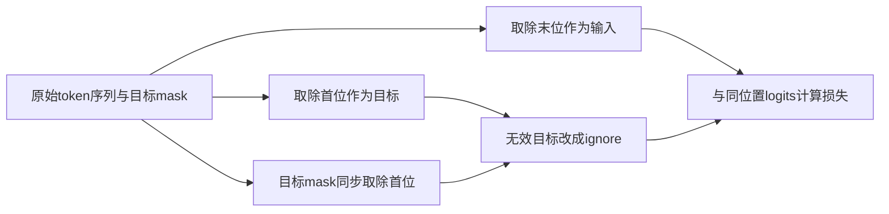
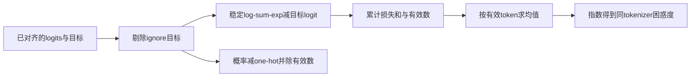
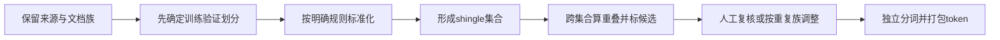

# 预训练目标与数据

公式记号：`card` 表示集合的元素个数，近重复比例的分子仍统计满足匹配条件的验证样本数。

预训练学习文本的条件分布，目标函数与语料处理共同决定优化方向。一个可靠的解释要说清楚“预测哪一个 token”“平均哪些损失”“验证集与训练集是否独立”，不能把总 loss 下降直接解释为推理能力或事实性提升。本文把这三处最容易藏错的边界拆成独立教学单元。[LLaMA 训练数据与方法](https://arxiv.org/html/2302.13971v1#S2)

前置学习：[Transformer与自回归生成](Transformer与自回归生成.md)。完整示例：[pretraining.py](../../examples/training/pretraining.py)。

## 学习目标

- 在数据整理和模型内部两种接口中追踪标签移位，避免重复移位或自我复制目标。
- 从 log-sum-exp 推导有效 token 的交叉熵及梯度，正确聚合变长样本。
- 量化跨集合重复候选，区分 token 打包、文档划分和语义泄漏检查。

## 前置知识

记文本 token 为 $x_0,\ldots,x_T$ ，每个位置的 logits 为 $z_t\in\mathbb R^V$ ， $V$ 是词表大小。自然对数损失单位是 nat/token。模型架构限制可见历史，标签 mask 只控制哪些预测参与损失；这两个 mask 不可混称。下面的示例使用预先给定 token 与 logits，不包含 tokenizer 训练和参数优化。

## 基本机制

因果语言模型最大化 $\prod_{t=0}^{T-1}p_\theta(x_{t+1}\mid x_{\le t})$ ，等价于最小化负对数之和。语料还需记录来源、许可、版本、清洗、去重和混合比例。LLaMA 第2.1节描述行级、文件级及书籍级去重，说明不同数据源可有不同粒度；这些是论文配方的陈述，不是本库重做了相同处理。[LLaMA 预训练数据](https://arxiv.org/html/2302.13971v1#S2.SS1)

## 推导或示例

### 知识点一：标签只能错位一次，mask属于目标位置

**问题与机制。** 如果输入和 label 相同，模型是在复制当前 token 吗？答案取决于模型是否在内部移位。外部移位接口构造

$$
\text{input}[t]=x_t,\quad\text{label}[t]=x_{t+1},\quad
\text{valid}[t]=m_{t+1},\qquad 0\le t\lt T,
$$

其中 $m_i$ 表示原序列第 i 个 token 是否作为目标训练。内部移位接口可接收同长 labels，但损失层取 `labels[...,1:]` 并对末位置补 ignore。两者应选一种，使最终 logits 与下一 token 一一对应。[nanoGPT get_batch 的外部错位](https://github.com/karpathy/nanoGPT/blob/3adf61e154c3fe3fca428ad6bc3818b27a3b8291/train.py#L115-L131) [Transformers ForCausalLMLoss 的内部错位](https://github.com/huggingface/transformers/blob/50e35cc0ca18ec19b80653690de553e6decf74f5/src/transformers/loss/loss_utils.py#L51-L73)

```python
def shift_targets(tokens, train_mask=None, ignore_index=-100):
    """外部错位一次，目标mask按目标token原始位置应用。"""
    if len(tokens) < 2:
        raise ValueError("至少需要两个token")
    if train_mask is None:
        train_mask = [True] * len(tokens)
    if len(train_mask) != len(tokens):
        raise ValueError("mask长度须与原序列一致")
    return {"input_ids": list(tokens[:-1]),
            "labels": [token if train_mask[i] else ignore_index for i, token in enumerate(tokens[1:], 1)]}
```

输入 `[10,11,12,0]`，末尾0是 padding，目标有效位 `[True,True,True,False]`。函数得到输入 `[10,11,12]`，标签 `[11,12,-100]`。位置1的隐藏状态包含 token11，监督它预测12；不能再把 label 改为13或往前取错一位。这里 token10 不作为目标，是因为没有在输入前加 BOS；加入 BOS 后可以监督第一个普通 token，但仍只移位一次。

这也解释两个 mask 的差异：即使某个提示 token 不作为监督目标，它仍可出现在历史中，让后续 token 读到。若把“label忽略”误用成“attention禁止读取”，条件分布变了。另一方面，把 padding 的 label 屏蔽掉，不自动阻止真实 token 读取 padding，注意力仍需有合适的可见范围。



**源码定位。** 该版本 nanoGPT 的 `get_batch` 从同一 token 流分别取 `i:i+block_size` 与 `i+1:i+1+block_size`，`GPT.forward` 直接交给 CE，使用 ignore=-1。Transformers 的通用损失默认 ignore=-100，内部补位并移位；不能假定两个项目的哨兵值相同。[nanoGPT GPT.forward 的损失调用](https://github.com/karpathy/nanoGPT/blob/3adf61e154c3fe3fca428ad6bc3818b27a3b8291/model.py#L184-L187) 目标是下一位置的依据也可对照 [Transformer 解码器移位与掩码](https://arxiv.org/html/1706.03762v7#S3.SS1)。

**条件与反例。** 示例返回的是已外部错位的 labels；交给默认内部移位模型会形成双重错位。只含一个 token 无法构造这里的训练对，因此拒绝。EOS 可以是合法训练目标，不能因它与 padding 复用一个 ID 就将所有相同 ID 一律屏蔽，应按实际位置 mask 判断。

### 知识点二：有效token分母决定梯度权重

**问题与机制。** 两个 batch 的 loss 都叫 mean，为什么合起来仍可能算错？令有效标记 $m_t=\mathbf1[y_t\ne ignore]$ ， $N=\sum_tm_t$ 。从 softmax 得到

$$
\ell_t=\log\sum_{v=1}^{V}e^{z_{t,v}}-z_{t,y_t},\qquad
L=\frac{\sum_tm_t\ell_t}{N}.
$$

令 $c_t=\max_vz_{t,v}$ ，log-sum-exp 改写为 $c_t+\log\sum_v e^{z_{t,v}-c_t}$ ，值不变而计算更稳定。对 logits 求导为

$$
\frac{\partial L}{\partial z_{t,v}}
=\frac{m_t}{N}\left(p_{t,v}-\mathbf1[v=y_t]\right).
$$

有效行梯度之和为零，因为 softmax 概率和与 one-hot 标签和都为一。无效行梯度为零，但历史中的对应隐藏状态仍可能通过后续注意力收到梯度，不能将两者混淆。[PyTorch 类索引交叉熵与ignore_index](https://docs.pytorch.org/docs/2.14/generated/torch.nn.CrossEntropyLoss.html)

```python
def token_loss(logits, targets, ignore_index=-100):
    """输入已对齐logits和目标，返回有效token平均CE、困惑度和解析梯度。"""
    if not logits or len(logits) != len(targets) or not logits[0]:
        raise ValueError("logits和目标须同长非空")
    width = len(logits[0])
    if any(len(row) != width for row in logits):
        raise ValueError("词表宽度须一致")
    count = sum(y != ignore_index for y in targets)
    if count == 0:
        raise ValueError("不能平均零个有效token")
    losses, gradients = [], []
    for row, target in zip(logits, targets):
        if not all(math.isfinite(x) for x in row):
            raise ValueError("logits须有限")
        if target == ignore_index:
            losses.append(0.0)
            gradients.append([0.0] * width)
            continue
        if not isinstance(target, int) or not 0 <= target < width:
            raise ValueError("目标索引越界")
        peak = max(row)
        exp_values = [math.exp(x - peak) for x in row]
        denom = sum(exp_values)
        losses.append(peak + math.log(denom) - row[target])
        gradients.append([(p / denom - float(j == target)) / count for j, p in enumerate(exp_values)])
    total = sum(losses)
    mean = total / count
    try:
        perplexity = math.exp(mean)
    except OverflowError:
        perplexity = math.inf
    return {"loss_sum": total, "valid_tokens": count, "mean_loss": mean,
            "perplexity": perplexity, "token_losses": losses, "gradients": gradients}
```

函数要求 logits 已与 targets 对齐，并返回逐 token 损失、总和、有效数、平均、困惑度和解析梯度。三个目标概率为 `[0.5,0.25,0.125]` 时，损失和 $\ln64$ 、平均 $\ln4$ 、困惑度 $e^{\ln4}=4$ 。若屏蔽第三个，则平均为 $\ln\sqrt8$ ，困惑度变成 $\sqrt8$ ；不能仍除以三。

变长聚合的反例更隐蔽：microbatch A 有1个有效 token、平均 loss=1；B 有3个、平均 loss=3。直接平均两个均值是2，按 token 正确合并则为 $(1\times1+3\times3)/4=2.5$ 。这对应给不同样本隐含不同权重，梯度也不相同。通用表达为 $L=\sum_bN_bL_b/\sum_bN_b$ 。分布式实现还要核对梯度规约尺度，这个标准库例子不模拟 DDP。



**源码定位。** 该版本 `fixed_cross_entropy` 在提供 `num_items_in_batch` 时使用 sum 再除指定分母，否则使用 mean。调用者传错分母，函数无法自动修正。[Transformers fixed_cross_entropy](https://github.com/huggingface/transformers/blob/50e35cc0ca18ec19b80653690de553e6decf74f5/src/transformers/loss/loss_utils.py#L34-L48) nanoGPT 的梯度累积把等大小 block 的 loss 除以累积步数，这在有效数相等时合理；不能机械复制到不同 mask 数的批次。[nanoGPT microbatch 损失缩放](https://github.com/karpathy/nanoGPT/blob/3adf61e154c3fe3fca428ad6bc3818b27a3b8291/train.py#L290-L305)

**条件与反例。** 推导针对类索引标签、无类别权重、无标签平滑；PyTorch 带类别权重时 mean 分母是有效权重和。全 ignore 输入没有可定义的 token 平均，示例明确报错。不同 tokenizer 把同一文本切成不同数量和粒度的 token，不能直接比较其 perplexity；比较时需固定语料、mask 与 tokenizer，或另行定义按字节等统一单位的指标。

### 知识点三：文档切分、重复候选与token打包

**问题与机制。** train 与 validation 的记录 ID 不同就没有泄漏吗？记录边界不等于内容独立。对标准化后的文档生成连续 k 个词组成的 shingle 集合 $A,B$ ，可计算

$$
J(A,B)=\frac{|A\cap B|}{|A\cup B|},\qquad
\rho=\frac{\mathrm{card}\lbrace v\in D_{val}:\exists t\in D_{train},J(t,v)\ge\tau\rbrace }{|D_{val}|}.
$$

$J$ 衡量这一表示下的重叠， $\rho$ 是被标记的验证文档比例，不是“污染造成分数虚高多少”的估计。标准化策略、词边界、k 和阈值都会影响候选；下面的空白分词只作透明教学，不适合直接用于所有中文文本。LLaMA 对不同来源采用不同去重粒度，也说明不能把一个简单阈值用于所有数据。[LLaMA 多粒度数据去重](https://arxiv.org/html/2302.13971v1#S2.SS1)

```python
def audit_split(train_docs, validation_docs, shingle_size=2, threshold=0.5):
    """用空白分词的shingle集合审计跨集合近重复；只报候选，不自动删文档。"""
    if not isinstance(shingle_size, int) or shingle_size <= 0 or not 0 < threshold <= 1:
        raise ValueError("shingle大小须为正整数，阈值须在(0,1]")
    def features(text):
        tokens = text.casefold().split()
        if not tokens:
            raise ValueError("不接受空文档")
        size = min(shingle_size, len(tokens))
        return tuple(tokens), {tuple(tokens[i:i + size]) for i in range(len(tokens) - size + 1)}
    train = [features(text) for text in train_docs]
    valid = [features(text) for text in validation_docs]
    pairs, affected = [], set()
    for i, (left_tokens, left) in enumerate(train):
        for j, (right_tokens, right) in enumerate(valid):
            score = len(left & right) / len(left | right)
            if score >= threshold:
                pairs.append({"train": i, "validation": j, "jaccard": score,
                              "exact": left_tokens == right_tokens})
                affected.add(j)
    return {"pairs": pairs, "flagged_validation": len(affected),
            "flagged_fraction": len(affected) / len(valid) if valid else 0.0}
```

取 `a b c d` 与 `a b c x`，二词 shingle 分别为 `{ab,bc,cd}` 与 `{ab,bc,cx}`，交集2、并集4，所以 $J=0.5$ ；与完全相同文档比较为1。若训练集中前一个文档与验证中的这两条比较，阈值0.5会标出两个验证文档， $\rho=1$ 。这不表示两份数据在语义上必然相同，结果需要结合原文和来源复核。

一种可审计的设计是先按文档族或来源族确定集合，再检查跨集合 exact/near duplicate；若发现连通的重复族，可将整族归入同一集合或隔离后重建。只随机切长文片段，会让共享上下文和近重复段落同时进入两侧。清洗和切分决策需保留原 ID 与变换记录，不能靠降低验证 loss 反推数据无泄漏。



**源码定位。** 该版本 nanoGPT 的 OpenWebText 准备脚本先对文档记录 `train_test_split`，再在 `process` 中分词并追加 EOT，最后把同集合 token 拼成流。此文件没有在这些步骤中实现本节的近重复审计；示例是为补足可见边界而自写，不能宣称维护者脚本已保证语义隔离。[nanoGPT 文档划分与token流构建](https://github.com/karpathy/nanoGPT/blob/3adf61e154c3fe3fca428ad6bc3818b27a3b8291/data/openwebtext/prepare.py#L25-L74)

打包还涉及训练语义：一篇文档末尾追加 EOT 并不等于注意力自动重置。普通因果 mask 仍允许后文读到前文；若要求严格文档隔离，需要另外的分段可见范围和位置规则。EOS/EOT 能提供边界信号，却不能替代注意力边界，这与第一知识点的“损失mask和读取mask不同”相呼应。

**条件与反例。** 集合式 Jaccard 忽略重复次数和许多长程顺序；模板相似、内容不同的文档可能误报，同义改写可能漏报。全量两两比较为 $O(|D_{train}||D_{val}|)$ 次相似度计算，只适用于小例；生产规模需候选生成和精确复核。没有命中不证明无泄漏，尤其不能覆盖语义改写或评测题答案的间接来源。

## 适用条件与限制

本文不构建或训练真实预训练语料。低损失只能说明指定数据和目标下的预测改善，不能替代独立事实测试、指令遵循或业务评估。数据混合还要报告采样比例与每来源有效 token，原始字节占比不等于模型看到的 token 占比；质量差异也不能只按训练轮数解释。

## 实践任务

交付一张原文到 token 到 label 的位置表、一张变长 microbatch 加权表和跨集合重复候选清单。分别检查 padding/EOT 共 ID、全 mask、重复移位及近重复漏报；记录所有有效 token 分母。本组未运行教学示例，交常驻 UT 核验；完整预训练和真实语料审计保持已设计。

## 掌握标准

能追踪任意 logits 对应的下一 token，说明移位发生在何处；能推导 CE 梯度和有效数分母，手算困惑度；能解释切分与打包不能保证内容隔离。验收需要具体索引、具体分母和具体候选证据，不能用“数据清洗过”代替可追溯记录。

## 源码与后续阅读

实际读取证据为 LLaMA 与 Transformer 相关章节、nanoGPT 的模型/训练/数据准备代码、Transformers 因果损失以及 PyTorch 2.14 CE 文档。未独立复现预训练质量或数据去重效果。后续阅读：[监督微调与LoRA](监督微调与LoRA.md)。

---

[返回模块](../modules/训练.md) · [知识点索引](../../docs/知识点索引.md) · [完整教学代码](../../examples/training/pretraining.py) · [提出更正](https://github.com/yanbozhang/llm-systems-wiki/issues/new?template=knowledge.yml)

觉得这篇推导有帮助，可以在 [GitHub](https://github.com/yanbozhang/llm-systems-wiki) 点 Star 收藏更新；分享时欢迎链接到具体知识点，便于读者复核公式、代码与来源。
